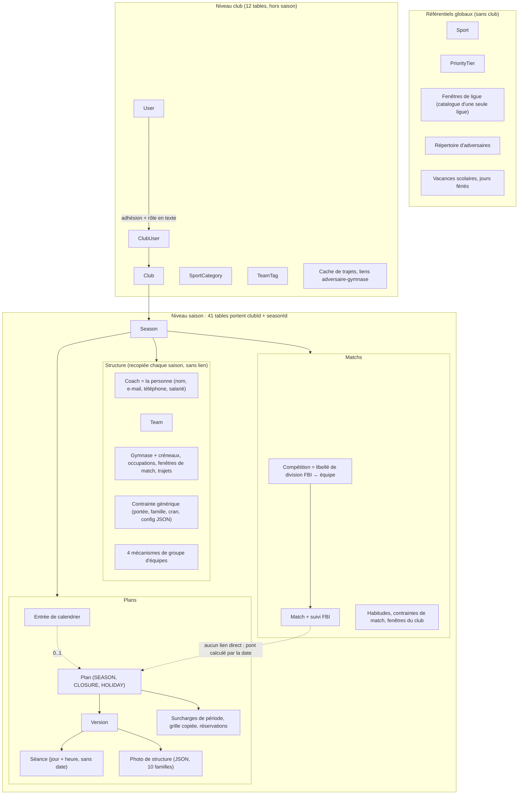
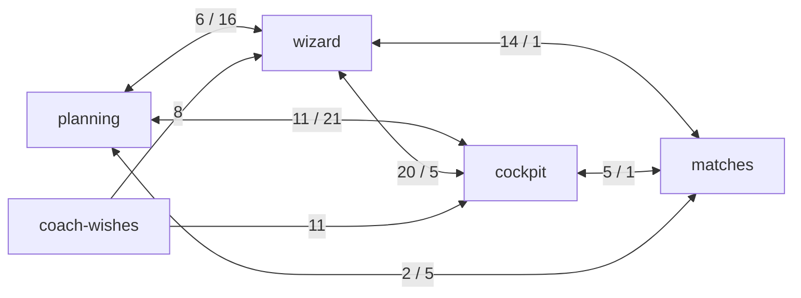
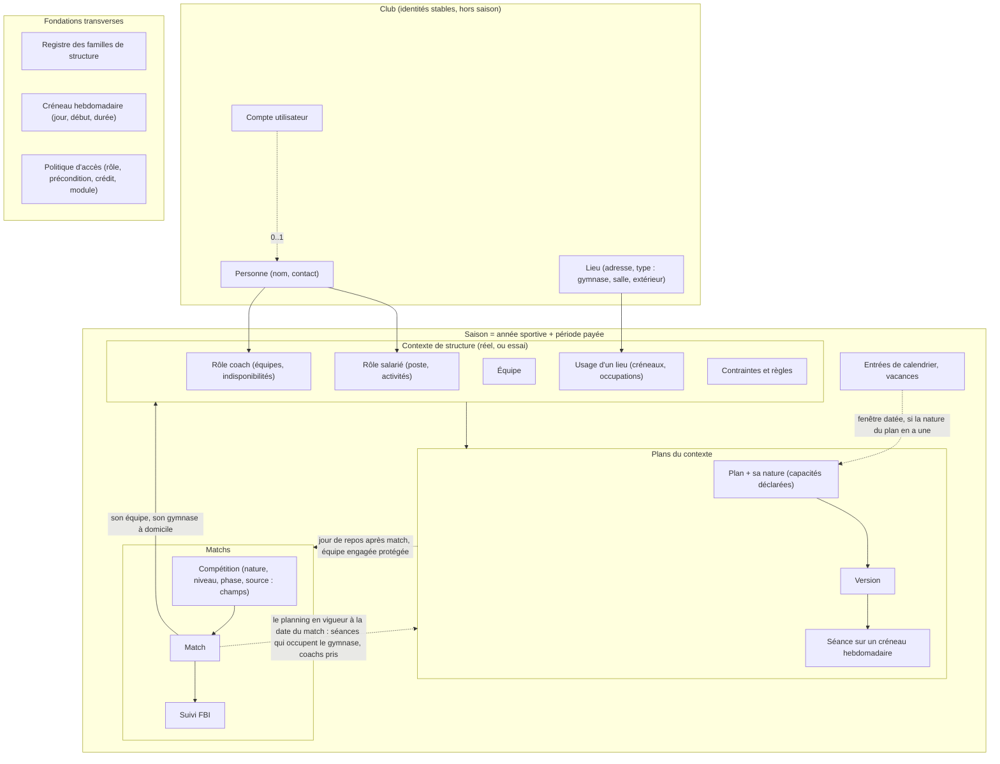
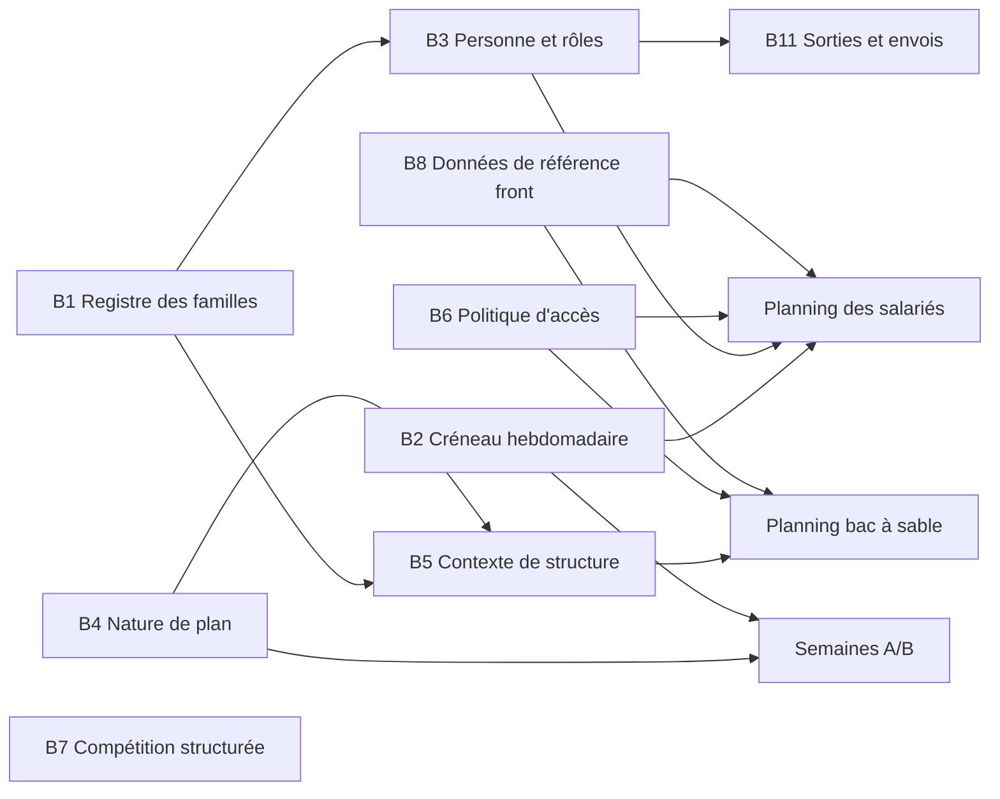

# Audit de conception d'Amateo — 2026-11-19

> Brief : [`specs/evolution/lot-conception.md`](../evolution/lot-conception.md) (ligne de roadmap P1-6).
> Question posée : nos fondations sont-elles solides, et comment les rendre modulables pour que les
> évolutions à venir ne coûtent pas « un bras » ?
> Lecture seule : rien n'a été codé ni exécuté. **Le découpage en lots de travail se décide après
> cet audit**, par le fondateur ; les « briques » du §7 décrivent des dépendances, pas un plan.

## 0. En une page

**Verdict global.** Les fondations de **sécurité et de justesse** sont solides : isolation entre
clubs, horloge, contrat avec le moteur, preuve d'effet des contraintes. Les fondations de
**modèle** ne le sont pas : le code est un ensemble de tables plates reliées par des identifiants
bruts, rangées sous le couple (club, saison), où chaque notion nouvelle se paie par des listes
tenues à la main. Le produit marche ; c'est son **coût d'évolution** qui est élevé, et il monte
à chaque ajout.

**Six causes racines** (détail au §3) :

| # | Cause racine | Ce qu'elle coûte aujourd'hui |
|---|---|---|
| R1 | **Aucune identité au-dessus de la saison.** Coach, équipe, gymnase sont recopiés chaque saison sans lien ; le coach EST la personne. | Pas de salarié non coach, pas d'historique, pas de structure d'essai. |
| R2 | **La saison sert à la fois de calendrier, de période payée et de conteneur de structure.** Le « socle » est codé de trois façons sans cohérence. | Bac à sable et semaines A/B n'ont nulle part où vivre. |
| R3 | **Le type de plan est binaire** (« socle, sinon période ») dans une quarantaine de fichiers backend et 14 côté front. | Un 4ᵉ type tombe en silence dans la branche « période ». |
| R4 | **Les familles d'objets sont énumérées à la main dans huit mécanismes**, dont les listes divergent déjà. | Une famille nouvelle = 6 à 9 endroits, dont la moitié sans filet. |
| R5 | **« A-t-on le droit ? » se décide par 13 mécanismes** câblés à la main ; aucune notion de module. | Un module nouveau touche environ 14 fichiers existants, dont 5 listes fermées. |
| R6 | **Les règles métier sont déduites de libellés** (compétitions) et **récrites en plusieurs exemplaires** (temps, règles du moteur, types du front). | Chaque règle coûte 12 à 18 fichiers ; la compétition a déjà généré un lot d'erreurs. |

**Ce qui est solide et qu'il ne faut pas toucher** (§5) : l'isolation entre clubs à trois couches et
ses tests par réflexion, l'horloge, le contrat backend ⇄ moteur testé contre le vrai moteur, les
deux solveurs, l'écriture réservée au gestionnaire par défaut, les 14 miroirs front sous test de
parité.

**Effet sur les trois besoins en attente** (§7.3) : le planning des salariés dépend de R1 ; le bac à
sable de R2, R3 et R4 ; les semaines A/B de R3. **Aucun des trois ne demande de toucher au moteur.**

## 1. Méthode et limites

- Cinq lectures parallèles du code (plans et cycle de vie ; matchs, compétitions, fédération ;
  structure du club et personnes ; transverse backend ; frontend et moteur), puis un inventaire
  global et une contre-vérification directe des constats qui portent une conclusion.
- **Contre-vérifié à la source** : l'absence de relations et de clés étrangères ; la liste des
  familles de la photo de structure et ce que lit le payload du moteur ; le choix de la saison
  courante ; la naissance d'une compétition à l'import ; les listes de routes de crédits et de
  quotas ; l'absence de voter ; les droits d'offre jamais lus ; la non-recopie de `isCtc` et des
  blocs de mutualisation à la saison suivante ; le branchement du worker de génération.
- **Non contre-vérifié** : les comptages de fichiers par motif (ordres de grandeur, commentaires
  inclus), les décalages ADR ⇄ code un par un, le détail du front. Liste au §11.
- Les tailles sont des ordres de grandeur en fichiers source touchés : **S** jusqu'à 10, **M** 10
  à 30, **L** 30 à 60, **XL** au-delà. Aucune n'est issue d'un essai.

## 2. Le modèle tel qu'il est

### 2.1 Taille

| Zone | Code (lignes) | Tests (lignes) |
|---|---|---|
| Backend `src/` | 150 000 (950 fichiers) | 218 000 (629 fichiers de test, 38 features Behat) |
| Frontend `src/` | 89 000 (542 fichiers) | 83 500 |
| Moteur `app/` | 20 300 (75 fichiers) | 29 400 |

Environ 90 tables, 78 entités, 219 migrations.

### 2.2 Carte des objets

### 2.3 Trois faits de structure

1. **Aucune relation entre objets dans le code.** 75 entités sur 78 n'ont aucune relation Doctrine
   (les trois exceptions sont des jetons de compte). Toute référence est une colonne `guid` nue :
   `clubId`, `seasonId`, `teamId`, `coachId`.
2. **Presque aucune clé étrangère en base** : 14 pour environ 90 tables. Le code l'assume par écrit :
   « Ces entités n'ont aucune association ORM ni clé étrangère […] La liste ci-dessous EST la seule
   intégrité référentielle du produit » (`backend/src/Deletion/CascadePlan.php:40-42`).
   S'y ajoutent des identifiants rangés dans du JSON (`Constraint.config`,
   `CoachWish.staffUnavailability`, `constraintIds`, la photo de structure) et des cibles
   polymorphes (`scopeTargetId`).
3. **Le code est rangé par couche technique, pas par domaine.** `backend/src/Service/` contient 207
   fichiers à plat (61 000 lignes). Le seul découpage par domaine, `Basketball`, est éclaté dans six
   couches. Côté front, les cinq grandes features (planning, wizard, cockpit, matchs, doléances)
   s'importent mutuellement : 147 imports croisés, un seul bloc cyclique.

## 3. Les six causes racines

### R1 — Aucune identité au-dessus de la saison

**Constat.**
- Un coach est une ligne de saison : prénom, nom, e-mail, téléphone, genre, `isEmployee`
  (`backend/src/Entity/Coach.php:33-73`). « Préparer la saison suivante » le recopie avec un nouvel
  identifiant, sans lien avec l'ancien (`SeasonTransitionService.php:40,269-287`). Les colonnes de
  lignée du schéma d'origine (`parent_coach_id`, `parent_team_id`, `parent_venue_id`) ne sont plus
  écrites.
- Un humain existe sous quatre formes sans rapprochement : `User` (compte), `Coach`, les contacts
  en colonnes plates sur `Club` (correspondant, président), l'adresse d'une invitation. Un
  gestionnaire qui entraîne est deux fiches sans lien.
- Le salarié est une case à cocher du coach, lue par le moteur (`wellness/salarie.py`).
- Le gymnase suit le même patron, alors que ce qui le décrit physiquement est déjà hors saison :
  cache de trajets et liens adversaire-gymnase sont au grain club (« un trajet est une constante »,
  `SeasonDataPurger.php:96-97`).

**Ce que ça rend cher.** Un salarié non coach ; « où était cette personne l'an dernier » ; un mail à
quelqu'un qui n'est ni un compte ni un coach (la boîte aux lettres de démonstration ne connaît que
ces deux tables, `ClockedClubMailInterceptor.php:164-185`) ; tout rôle nouveau (bénévole, arbitre,
membre du bureau).

### R2 — La saison porte trois rôles, et le socle trois encodages

**Constat.**
- La saison est en même temps l'année sportive (calendrier, vacances), la période payée
  (`paidSeasonYear`) et le **conteneur de toute la structure** (41 tables).
- La saison courante se choisit parmi **toutes** les saisons du club dont le début tombe dans
  l'année en cours (`SeasonResolver.php:67-107`) : une saison d'essai le deviendrait. 45 fichiers
  appellent ce résolveur, une vingtaine relisent l'en-tête `X-Season-Id` à la main, et le code des
  plans contourne le filtre global en SQL brut (une douzaine de sites dans
  `SchedulePlanProvisioner`). L'unicité « une saison par année » ne tient que par un verrou
  applicatif.
- « Le socle » est encodé de trois façons sans contrainte de cohérence entre elles : le type
  `SEASON` du plan, l'absence d'entrée de calendrier, et l'ancre `schedulePlanId IS NULL` sur les
  lignes de structure (23 fichiers lisent cette convention).
- L'indépendance des versions repose sur une **photo JSON partielle** : « Charger cette version »
  en saison **efface la structure vivante du club et la remplace** par la photo
  (`RegenerateFromVersionController.php:116-131`, `StructureRestorer.php:259-318`). En période, le
  même mot « Charger » pose un simple pointeur.

**Ce que ça rend cher.** Toute deuxième structure à côté de la vraie : essai, variante, simulation.
Aujourd'hui, essayer une organisation oblige à modifier la structure réelle et à rouvrir le socle,
ce qui détruit les plans de période futurs.

### R3 — Le type de plan est binaire

**Constat.**
- L'enum a trois valeurs (`SEASON`, `CLOSURE`, `HOLIDAY`) mais aucun `match` exhaustif ne le lit :
  tout est en `if` « SEASON, sinon période ». Une quarantaine de fichiers backend branchent ainsi
  (21 citent l'enum, les autres passent par `planIsSeason`, `periodEntryIdOf` ou des chaînes SQL),
  et 14 fichiers front de production, dont 14 négations de `isSeasonPlanType`.
- Le worker de génération décide « socle ou période » par la présence d'une entrée de calendrier
  (`GenerateScheduleHandler.php:221-223`), pas par le type.
- Un second enum parallèle, le type de l'entrée de calendrier, porte le reste des variations (14
  fichiers).
- Un plan hors socle est soudé 1:1 à une entrée de calendrier et à ses dates (`startDate` et
  `endDate` obligatoires) ; la seule porte de création l'exige.
- Le cycle de vie n'est pas un automate : l'état d'une version se dérive de cinq champs sur trois
  tables, et chaque guichet (générer, régénérer, combler, charger, valider, rouvrir) récrit ses
  gardes. Seuls `SocleGuard` et `VersionEditability` sont de vrais foyers uniques.

**Ce que ça rend cher.** Un plan **sans date** (variante de semaine, essai) : il serait pris pour le
socle par le worker, prendrait le verrou de la saison, et sa validation proposerait de détruire les
plans de période futurs.

### R4 — Huit mécanismes énumèrent « toute la structure », chacun à sa façon

| Mécanisme | Familles listées | Filet par test |
|---|---|---|
| Copie vers la saison suivante (`SeasonTransitionService::copy`, une méthode de 450 lignes) | 16, champ par champ | Aucun |
| Photo d'une version (`StructureSnapshotter::FAMILIES`) | 10 | Les listes entre elles, pas la complétude |
| Restauration et effacement (`StructureRestorer`) | Les mêmes 10, deux fois | Idem |
| Payload du moteur (`ScheduleConstraintBuilder`) | 13, répétées pour la période | Forme du payload |
| Copie à la naissance d'un plan de période | 4 | Colonnes des créneaux seulement |
| Copie d'un plan frère | 9 | Non vérifié |
| Purge des réglages d'un plan | 9 (clé étrangère sur 6) | 5 tables |
| Suppression en cascade (`CascadePlan`) | Par équipe, gymnase, coach, créneau | Parité annonce/exécution |
| Purge de saison, export RGPD, isolation | Toutes | **Oui, par réflexion** |

**Les listes divergent déjà** (vérifié) :
- les blocs de mutualisation du socle partent au moteur mais ne sont ni photographiés ni recopiés à
  la saison suivante ;
- les passerelles entre équipes, les trajets et les règles du club influencent le solve mais sont
  hors photo : « Charger cette version » restaure une partie seulement de ce que le solve a lu ;
- `isCtc` et `ctcPartner` d'une équipe ne sont pas recopiés à la saison suivante.

**Ce que ça rend cher.** Chaque objet nouveau (une activité de salarié, par exemple) coûte 6 à 9
points de mise à jour, et l'oubli est silencieux partout où il n'y a pas de test de complétude.
Mesure sur la dernière entité ajoutée (occupation de gymnase) : 6 fichiers propres et **9 fichiers
existants modifiés**.

### R5 — « A-t-on le droit ? » : treize mécanismes, aucun module

**Constat.**
- Aucun voter, aucun attribut de sécurité. Le rôle est un texte libre de 20 caractères
  (`ClubUser.php:39-40`).
- La règle « écriture = gestionnaire » est un défaut hérité pour les 33 processeurs d'API (le seul
  vrai mécanisme central), mais un appel manuel dans 46 contrôleurs, et elle est récrite à neuf
  autres endroits.
- La précondition « socle validé » est un appel manuel dans 17 fichiers ; rien ne l'impose.
- Les crédits et les quotas sont des **listes de noms de routes** dans deux écouteurs plus un
  fichier de limiteurs. Elles divergent : `/fill` lance un solve sans consommer de crédit.
- **Aucune notion de module activable.** L'offre porte déjà `features` et `maxVenues`
  (`SubscriptionPlan`), que rien ne consulte.
- La règle du 1er mai (« Préparer la saison suivante ») n'existe que côté écran.

**Ce que ça rend cher.** « Ce module est disponible quand le socle est validé, écrit par le
gestionnaire, lu par le Membre, son export coûte un crédit » : environ 14 fichiers existants, dont 5
listes fermées.

### R6 — Des règles déduites de libellés et récrites en plusieurs exemplaires

**La compétition.**
- Une compétition est la correspondance « libellé de division FBI ↔ équipe ». Elle n'a ni niveau,
  ni phase, ni format ; son seul champ structuré, le type, ne décide presque rien.
- Sa nature se relit par analyse de chaînes à quatre endroits qui ne sont pas d'accord entre eux. À
  l'import, tout ce qui ne contient pas « brassage » naît « championnat », coupe comprise
  (`FbiFixtureImporter.php:1727-1734`).
- **Deux définitions d'« amical » coexistent** : compétition absente (placement, radar, saisie) et
  nom commençant par « amical » (validation de ligue, export).
- Les règles vivent sur l'équipe et la catégorie, jamais sur la compétition : fenêtres de ligue,
  durée de match tirée du nom de la catégorie, un seul créneau idéal par équipe, un seul niveau par
  équipe.
- La fédération est en dur : un seul catalogue de fenêtres, avec **repli silencieux** sur la ligue
  de référence pour un club d'une autre ligue ; cinq expressions régulières différentes lisent le
  code du club.
- `Fixture` fusionne le match et son suivi FBI ; domicile/extérieur est binaire, le terrain neutre
  est encodé dans une raison de dépointage, l'adversaire est un texte unique.

**Le temps.**
- Aucun objet « créneau hebdomadaire ». Le triplet jour + heure + durée est recopié dans quatre
  entités, sous quatre formes de stockage au total (colonnes, JSON, chaînes `HH:MM`, un reliquat
  0 = lundi). Le code compte 14 conversions heure → minutes privées, 8 tests de chevauchement
  récrits, 7 calculs du « lundi de la semaine », et une quinzaine de conversions date → jour de
  semaine dans le module matchs.

**Les règles du moteur.**
- Chaque règle existe en quatre ou cinq couches : analyse, pose, diagnostics, verdict de
  déplacement, puis **miroirs PHP** avant génération (`PreSolvePreventionWarnings`, 1 735 lignes,
  récrit une vingtaine de règles du moteur) et miroirs front. Mesure sur un champ réel
  (`maxSessionsPerDay`) : 39 fichiers de production.

**Les types du front.**
- Écrits à la main, sans génération. Équipe, coach et gymnase sont déclarés **trois fois** (wizard,
  planning, matchs) ; la même donnée vit sous plusieurs clés de cache, reliées par un pont manuel
  (`invalidateEverywhere`). 120 racines de clé de cache, 230 sites d'invalidation, aucune fabrique.

## 4. Verdict par objet

Lecture : **Solide** = à garder tel quel. **Fragile** = marche, mais chaque évolution coûte ; à
corriger quand on y touche. **À refaire** = le modèle lui-même bloque des besoins connus.

| Objet | Verdict | Ce qu'il suppose en dur | Deuxième usage probable | Coût d'un deuxième type aujourd'hui | Correction | Effet sur les trois besoins |
|---|---|---|---|---|---|---|
| Isolation entre clubs (filtre, RLS, tests par réflexion) | **Solide** | Une colonne `club_id` par table | Toute entité nouvelle | 1 bloc de migration, signalé par les tests | — | Protège les trois |
| Horloge (`ClubClock`, `ClubDay`) | **Solide** | — | Coupure du 1er mai côté serveur | — | — | Bac à sable |
| Contrat backend ⇄ moteur et ses tests | **Solide** | Payload = contrat = photo = empreinte de péremption | Tout champ nouveau | 7 littéraux de version, empreintes qui changent | Garder le payload identique pendant les refontes | Contrainte de B3 |
| Solveur d'entraînement | **Solide** | Variable = équipe × gymnase × jour × heure, sans date | Variante de semaine | Aucun si la variante est un plan résolu à part | — | Aucun des trois n'y touche |
| Solveur de placement des matchs | **Solide** | Date imposée, découpe par semaine ISO | — | — | — | Aucun |
| **Personne** (coach, compte, contacts) | **À refaire** | Le coach est la personne, par saison | Salarié, bénévole, arbitre, bureau | Un faux coach, qui entre dans le solveur | B3, **L** | Salariés : bloquant |
| **Saison comme conteneur** | **À refaire** | Une saison = une année = une structure | Essai, simulation | Une saison cachée qui peut devenir « courante » | B5, **M à XL** selon la voie | Bac à sable : bloquant |
| **Type de plan** | **À refaire** | Socle, sinon période datée soudée à une entrée | Variante de semaine, essai | Environ 40 fichiers backend, 14 front | B4, **L** | A/B et bac à sable : bloquant |
| **Familles de structure** (huit listes) | **À refaire** | Chaque mécanisme connaît sa liste | Activité de salarié, tout objet nouveau | 6 à 9 endroits, moitié sans filet | B1, **S à M** | Abaisse le coût des trois |
| **Droits, modules, crédits** | **À refaire** | Deux rôles, une offre bridée, un compteur | Module salariés, tout module | Environ 14 fichiers, 5 listes | B6, **M à L** | Salariés, bac à sable |
| **Compétition** | **À refaire** | Source FBI, nature déduite d'un libellé | Coupe, tournoi, compétition en semaine, autre ligue | 15 à 20 fichiers | B7, **L** | Aucun des trois |
| Cycle de vie des versions | **Fragile** | État dérivé de 5 champs, gardes par guichet | Un état de plus (publié, archivé) | 12 à 15 fichiers | Avec B4 | A/B, bac à sable |
| Photo de structure | **Fragile** | JSON indexé par nom de classe et de champ, restauré par effacement | Toute migration d'identité | Migration de toutes les photos en base | Avec B1 et B3 | Salariés (migration), bac à sable |
| Intégrité référentielle | **Fragile** | Tenue par le code seul | Toute entité nouvelle | Orphelins silencieux si la cascade oublie | B10, par table | Les trois |
| Créneau hebdomadaire et temps | **Fragile** | Triplet recopié, arithmétique récrite | Activité de salarié, variante de semaine | 4 entités, 8 chevauchements | B2, **M** | Salariés, A/B |
| Contrainte générique | **Fragile** | 5 familles, config validée par un tableau | Règle nouvelle | 12 à 18 fichiers (gardé par preuve d'effet) | Pas maintenant | Aucun |
| Groupes d'équipes (tags, blocs, passerelles, expansion club) | **Fragile** | Quatre mécanismes qui ne se connaissent pas | Groupe d'entraînement, section | Un cinquième mécanisme | À regarder avec B1 | Aucun |
| Gymnase | **Fragile** | Tout lieu est un gymnase plaçable par le solveur | Salle de réunion, école, terrain extérieur | Il apparaît dans le payload, le radar, les trajets | Un type de lieu, avec B3 | Salariés (lieu d'une activité) |
| `Fixture` (match + suivi FBI) | **Fragile** | Un adversaire, domicile ou extérieur | Plateau, derby, match hors FBI | 48 fichiers le référencent | Avec B7 | Aucun |
| Fédération et ligue | **Fragile** | Une ligue de référence, repli silencieux | Club d'une autre ligue | 1 fichier de données si le repli est assumé | Supprimer le repli silencieux | Aucun |
| Sport | **Solide si assumé** | Basket, FFBB | Second sport | 35 fichiers et plus | **Ne pas le faire** ; l'écrire | Aucun |
| Exports | **Fragile** | Trois rails, l'asynchrone soudé à `Schedule` | PDF des salariés | Environ 11 fichiers | B11, **M** | Salariés |
| Communications | **Fragile** | 34 sites d'envoi, 5 mémoires d'envoi | Mail aux salariés, aux familles | Une boucle de plus, un marqueur à ne pas oublier | B11, **M** | Aucun des trois |
| Rangement du backend | **Fragile** | 207 services à plat | Tout module | 9 fichiers existants par entité | B9, au fil de l'eau | Les trois |
| Données de référence du front (types, cache) | **À refaire** | Un `api.ts` par feature, clés sans contexte | Module salariés, contexte d'essai | Une 4ᵉ copie de `Coach`, ou tout vider à chaque bascule | B8, **M à L** | Les trois |
| Écrans d'orchestration (`PlanningPage` 1 876 lignes, 3 usages) | **Fragile** | Socle ou période, par props | Variante, essai | Passe par ces fichiers | Avec B4 | A/B, bac à sable |

## 5. Ce qui est solide

1. **L'isolation entre clubs.** Colonne, filtre Doctrine, RLS forcée, et quatre tests par réflexion
   qui rougissent sur l'oubli (`TenantOwnedInterfaceCompletenessTest`, `RlsIsolationTest`,
   `PurgeCompletenessTest`, `RgpdExportCompletenessTest`). C'est le patron à généraliser : là où un
   test de complétude existe, l'ajout d'une entité est borné et signalé.
2. **L'horloge.** Un point d'entrée, une horloge réelle nommée pour la sécurité, une centaine de
   fichiers qui la traversent pour trois écarts d'allure métier.
3. **Le contrat avec le moteur.** Testé contre le vrai moteur, champs inconnus refusés, preuve
   d'effet clé par clé (`ConstraintKeysAreHonouredByEngineTest`), codes de diagnostic en listes
   fermées, un seul constructeur de payload pour la génération et le verdict de déplacement.
4. **Les deux solveurs sont isolés l'un de l'autre** : ajouter un problème n'oblige pas à toucher
   l'autre. Le solveur ne connaît aucun type de plan.
5. **L'écriture réservée au gestionnaire par défaut**, et le balayage du routeur
   (`MemberWriteSweepTest`) qui fait rougir toute route d'écriture non décidée.
6. **Côté front** : la frontière `shared` → `features` est gardée par le linter ; capacités et
   droits sont calculés par le serveur ; 14 miroirs de règles sont sous test de parité.

## 6. Le modèle cible

### 6.1 Principes

1. **Une identité stable au niveau du club**, des rôles et des participations au niveau du contexte.
2. **Un contexte de structure explicite** : la saison reste l'année et la période payée ; le jeu de
   structure devient un objet nommé, qui peut exister en plusieurs exemplaires (réel, essai).
3. **Un plan décrit ses capacités** au lieu d'être deviné par « socle ou pas » : a-t-il des dates,
   hérite-t-il du socle, est-il détruit à la réouverture, se valide-t-il, s'exporte-t-il.
4. **Un registre unique des familles de structure**, lu par tous les mécanismes de copie, de photo,
   de purge, et gardé par un test de complétude.
5. **Une politique d'accès déclarée à côté de la route** : rôle, précondition, crédit, quota, module.
6. **Une règle métier a un seul foyer** : la nature d'une compétition s'écrit en champs à l'import ;
   le créneau hebdomadaire est un objet ; les types du front sont générés.

### 6.2 Schéma cible

**Le lien matchs ⇄ entraînement** (ajouté après relecture du fondateur : la première version de ce
schéma l'omettait). Il existe et il est fort, mais il n'est stocké nulle part, il est **calculé** :

- **Un match pointe la structure** : son équipe et, à domicile, son gymnase (`Fixture.teamId`,
  `Fixture.venueId`).
- **Un match lit le planning par sa date** : la date du match désigne le planning en vigueur ce
  jour-là (le plan de période le plus étroit qui la couvre, sinon le socle :
  `EffectiveScheduleResolver.php:50-81`), puis les séances de ce jour de semaine. C'est ce qui
  permet de dire « pas de match ici, il y a un entraînement » au radar, et d'envoyer au solveur de
  placement les occupations du gymnase déjà projetées sur les dates.
- **L'entraînement lit les matchs** : jour de repos tiré de l'habitude de match, équipe engagée en
  compétition protégée contre la suppression ou le changement de niveau.
- **La validation du socle est déjà la gâchette côté matchs** : un match qui pointe un gymnase
  disparu est dépointé à la validation, pas avant (`ValidateScheduleController.php:252-262`). Le
  principe « le socle est froid » y est donc déjà appliqué.

Dans la cible, ce lien passe par **une seule porte** : « quelle structure et quel planning sont en
vigueur à telle date ». Les matchs ne lisent jamais un socle en cours de travail.

### 6.3 La nature d'un plan, à la place du type binaire

| Nature | A des dates | Structure | Hérite du socle | Détruit à la réouverture du socle | Se valide | S'exporte | Existe aujourd'hui |
|---|---|---|---|---|---|---|---|
| Socle | Toute la saison | Celle du contexte | — | — | Oui | Oui | Oui (`SEASON`) |
| Ajustement | Fenêtre datée | Surcharges | Oui, copie à la naissance | Oui si pas commencé | Oui | Oui | Oui (`CLOSURE`) |
| Reprise de vacances | Fenêtre datée | Surcharges | Oui | Oui si pas commencé | Oui | Oui | Oui (`HOLIDAY`) |
| Variante de semaine | **Non** | Surcharges | Oui, copie à la naissance | À décider | Oui | Oui | Non (semaines A/B) |
| Socle d'essai | **Non** | Celle d'un contexte d'essai | — | Non | **Non** | **Non** | Non (bac à sable) |

Une quarantaine de `if` « socle, sinon période » deviennent des lectures de capacité. Ajouter une
nature revient alors à ajouter une ligne et à traiter les capacités nouvelles, plus à relire chaque
branche.

### 6.4 Ce que le modèle cible ne fait pas, volontairement

- **Pas de multi-sport.** Le sport est un décor ; l'assumer par écrit coûte une phrase, le
  généraliser coûte 35 fichiers sans besoin connu.
- **Pas de modèle neutre pour le solveur.** Équipe × gymnase × jour × heure est le bon modèle pour
  ce produit. Les variantes de semaine se résolvent comme un plan à part, par le mécanisme de copie
  du socle déjà en place (ADR-0004), sans dimension de plus dans le moteur.
- **Pas de planning des salariés dans le solveur.** Il est informatif.
- **Pas de renommage général ni de déménagement d'un bloc.** Le rangement par domaine se fait au
  fil des briques.

## 7. Chemin de migration : les briques et leurs dépendances

Rappel : ce sont des dépendances techniques. Le découpage en lots reste à décider.

### 7.1 Les briques

| Brique | Contenu | Taille | Risque |
|---|---|---|---|
| **B1 Registre des familles** | Une déclaration par famille de structure (copiée à la saison suivante ? photographiée ? ancrée au plan ? envoyée au moteur ?), lue par les mécanismes du §R4, plus un test de complétude par réflexion. Tranche au passage les écarts du §9. | S à M | Faible ; change ce que « Charger » restaure si l'on comble les trous |
| **B2 Créneau hebdomadaire** | Un objet (jour, début, durée) avec chevauchement et conversions, embarqué dans les quatre entités sans changer les colonnes ; un foyer pour date → jour de semaine. | M | Faible, mécanique |
| **B3 Personne et rôles** | Personne au niveau du club ; le coach devient un rôle de contexte qui garde son identifiant, pour que le payload du moteur reste identique au caractère près. Migration des photos existantes. Les contacts du club et le lien compte ↔ personne peuvent suivre. | L (25 à 35 fichiers backend, 10 à 15 front, 0 à 3 moteur, 2 à 3 migrations) | Moyen : RGPD, photos, purge |
| **B4 Nature de plan et cycle de vie** | Un descripteur de capacités par nature ; un seul encodage du socle ; un seul pointeur « version chargée » ; les gardes des guichets regroupées. | L (environ 40 fichiers backend, 14 front) | Élevé : génération, ADR-0002 |
| **B5 Contexte de structure** | Voie courte : la saison reçoit une nature (réelle, essai) et un seul résolveur décide ce qui est « courant ». Voie longue : un objet « jeu de structure » possède les 41 tables. | M à L (voie courte), XL (voie longue) | Élevé : isolation, 45 appelants, facturation, crons |
| **B6 Politique d'accès** | Rôle, précondition (socle validé), crédit, quota et module déclarés sur la route, lus par un seul écouteur ; `features` de l'offre enfin consultées ; règle du 1er mai côté serveur. | M à L | Moyen : sécurité, à falsifier route par route |
| **B7 Compétition structurée** | Un seul classifieur à l'import écrit des champs (nature, niveau, phase, source) ; une seule définition d'« amical » ; les règles se lisent sur la compétition avec repli sur l'équipe ; plus de repli silencieux de ligue. | L | Moyen ; montée de contrat si les fenêtres descendent au match |
| **B8 Données de référence du front** | Un foyer pour équipes, coachs, gymnases ; une fabrique de clés de cache qui porte le contexte ; types générés depuis le contrat OpenAPI déjà figé en instantané. | M à L | Faible à moyen |
| **B9 Rangement par domaine** | Espaces de noms par domaine côté backend, règle de dépendance entre features côté front. | Continu | Faible, bruyant en revue |
| **B10 Intégrité** | Clé étrangère obligatoire pour toute table nouvelle ; clés sur le cœur posées sans validation puis validées. | S par table | Faible si progressif |
| **B11 Sorties et envois** | Un point d'entrée « envoyer au club » ; un registre d'exports dont le rail asynchrone ne dépend plus d'une version de planning. | M chacun | Faible |

### 7.2 Dépendances

B7 n'est requise par aucun des trois besoins : elle répond au constat de départ sur les
compétitions et peut se placer où le fondateur le décide.

### 7.3 Effet sur les trois besoins

| Besoin | Briques nécessaires | Briques utiles | Ce qui reste à construire ensuite |
|---|---|---|---|
| **Planning des salariés** | B3, B2, B1 | B6, B8, B11 | Le rôle salarié, l'activité hebdomadaire, un écran, un export : un module de taille M, sans faux coach |
| **Semaines A/B** | B4 | B2 | Une nature « variante », sa naissance par copie du socle, le choix de la variante par le gestionnaire : M. Moteur inchangé |
| **Planning bac à sable** | B4, B5, B1 | B6 (1er mai), B8 (cache par contexte) | Créer un contexte d'essai par copie pilotée par le registre, le griser au 1er mai : M |

**Sans les briques**, les trois besoins restent faisables, mais chacun contourne le même défaut à sa
manière : un faux coach pour le salarié, une saison cachée pour l'essai, une « période » sans date
pour la variante. C'est ce qui s'est passé avec les compétitions.

## 8. Confrontation des ADR

| ADR | Sort proposé | Pourquoi |
|---|---|---|
| **ADR-0001** — solve en une passe, « la réservation gagne » | **Maintenu** | Le backend y est conforme ; aucune brique ne le touche. |
| **ADR-0002** — pattern « Plan » | **Amendé en profondeur, ou remplacé** | Le cœur tient (un plan nommé, des versions, un pointeur). Changent : le type devient une nature à capacités (B4) ; le socle n'a plus qu'un encodage ; le pointeur « version chargée » est unique (l'ADR le dit déjà, le code ne le fait pas) ; un plan peut ne pas avoir de dates. « Valider ou rouvrir le socle détruit les plans futurs » reste vrai pour les ajustements et les reprises, pas pour un essai. **Huit décalages entre l'ADR et le code** sont à solder dans le même geste (dont : « N plans par déclencheur » contre un seul par entrée ; le terme *liveContext* banni par l'ADR mais présent en base ; la source de verrous dite commune au socle et aux périodes, jamais écrite pour le socle). |
| **ADR-0003** — placement des matchs | **Maintenu, à rafraîchir** | Le moteur y est conforme sur le fond. Six décalages de rédaction (champs sortis du contrat encore décrits, version de contrat, nombre de raisons). La modélisation de la compétition n'y figure pas : elle mérite son propre ADR (B7). |
| **ADR-0004** — un plan de période naît en copie du socle | **Maintenu, et étendu** | C'est le mécanisme de naissance qui permet la variante de semaine sans toucher au moteur. |
| Décision implicite — isolation à trois couches | **Maintenue, à formaliser en ADR** | C'est le point le plus solide du dépôt. |
| Décision implicite — contrat backend ⇄ moteur synchronisé à la main | **Maintenue** | Bien gardée. À ajouter : une règle écrite « une refonte de structure garde le payload identique », parce que le payload sert aussi d'empreinte de péremption. |
| Décision implicite — génération asynchrone | **Maintenue** | Non remise en cause. |

**ADR nouveaux à écrire si la cible est validée** : Personne et rôles ; contexte de structure ;
registre des familles ; politique d'intégrité référentielle (aujourd'hui un choix écrit seulement
dans un commentaire de code) ; politique d'accès et modules ; modèle de la compétition.

## 9. Écarts concrets relevés au passage

Chacun est à trancher : voulu, ou oubli. Aucun n'a été corrigé.

| # | Écart | Preuve | Vérifié à la source |
|---|---|---|---|
| 1 | `isCtc` et `ctcPartner` d'une équipe ne sont pas recopiés à la saison suivante | `SeasonTransitionService.php` (aucune occurrence), `Team.php:95,103` | Oui |
| 2 | Les blocs de mutualisation du socle ne sont ni recopiés à la saison suivante ni photographiés | `SeasonTransitionService.php`, `StructureSnapshotter.php:52-63` | Oui |
| 3 | « Charger cette version » ne restaure ni les passerelles, ni les trajets, ni les règles du club, pourtant lus par le solve | `ScheduleConstraintBuilder.php:312-320` contre `StructureSnapshotter.php:52-63` | Oui |
| 4 | `/fill` lance un solve sans consommer de crédit Découverte | `ClubQuotaSubscriber.php:53-58` contre `CreditBudgetSubscriber.php:46-56` | Oui |
| 5 | Le PDF de planning consomme son crédit à la mise en file ; un rendu en échec n'est pas remboursé | `CreditBudgetSubscriber.php:65-71`, `ExportPdfHandler.php:72-75` | Non |
| 6 | Deux définitions d'« amical » : une compétition « Amical X » typée championnat part au solveur mais sort du « validé ligue » | §R6 | Non |
| 7 | Un club d'une autre ligue reçoit les fenêtres de la ligue de référence, étiquetées comme telles | `ClubLeagueWindowSeeder.php:49-54` | Non |
| 8 | La copie des blocs à la naissance d'un plan n'emporte pas le libellé, alors que la copie d'un plan frère l'emporte | `SchedulePlanProvisioner.php:1354-1358`, `PeriodPlanSiblingCopier.php:210-211` | Non |
| 9 | La restauration d'une version efface les catégories au grain du club, sans la saison | `StructureRestorer.php:274` | Non |
| 10 | Les droits d'offre `features` et `maxVenues` sont stockés et jamais consultés | `SubscriptionPlanResource.php:67,69`, seuls lecteurs | Oui |
| 11 | La règle du 1er mai n'existe que côté écran | `frontend/src/app/seasonTransition.ts:39-56` | Non |
| 12 | Trois journaux de rappel n'ont pas de `club_id` : hors RLS et hors tests de complétude | `HolidayReminderLog`, `TransitionReminderLog`, `PeriodReminderLog` | Partiel (colonnes vues) |
| 13 | Des noms de personnes ou de clubs figurent dans des commentaires de code (règle de provenance) | `FfbbRencontreReconciler.php:27`, `Competition.php:60`, `MatchConflictDetector.php:47`, `MatchFootprint.php:82` | Non |
| 14 | Une copie de l'union `SchedulePlanType` et une de `ScheduleStatus` côté front échappent à la garde de synchro avec le backend | `cockpit/api.ts:90`, `wizard/api.ts:975` | Non |
| 15 | Le brief annonçait 62 fichiers backend mentionnant « coach » ; la mesure large en donne 200, dont 46 touchent l'entité | §3 de la lecture « structure » | Non |

### Tri du fondateur (2026-11-19)

| # | Verdict | Ce qui est décidé |
|---|---|---|
| 1 | Voulu | L'entente entre clubs n'est pas recopiée : rien ne garantit qu'elle dure la saison suivante |
| 2 | Voulu pour la saison suivante ; oubli pour les versions | Les mutualisations ne sont pas recopiées à la saison suivante ; une version doit les contenir (voir 3). Les passerelles, elles, sont bien recopiées (`SeasonTransitionService.php:374-385`) |
| 3 | Oubli | « Charger » ramène l'état complet de la génération : passerelles, contraintes, mutualisations comprises |
| 4 | Oubli | Le comblement fait tourner le moteur : il consomme un crédit |
| 5 | Oubli, vérifié | Le crédit du PDF se consomme quand le PDF est obtenu. Aujourd'hui il part quand la demande est acceptée (`CreditBudgetSubscriber.php:59-72`) et un rendu en échec ne le rend pas (`ExportPdfHandler.php:68-75`). Le patron existe : le placement des matchs décompte à la fin du traitement |
| 6 | Tranché (2026-11-20) | Un match amical est un match d'une compétition de nature « amical », sans règle ; une compétition « Amicaux » existe d'office par saison. Les deux représentations actuelles sont vérifiées : match sans compétition (`MatchPlacementPayloadBuilder.php:464`) et compétition au libellé « amical » (`FriendlyAutoValidator.php:25-26`, `FbiDivisionSignature.php:79`) |
| 7 | Voulu, à compléter | Le repli sur la ligue de référence reste ; l'écran doit le dire au club dont la ligue est absente du catalogue, et à lui seul |
| 8 | Oubli, vérifié | À la naissance d'un plan de période on copie tout : le libellé d'un bloc de mutualisation doit suivre (`SchedulePlanProvisioner.php:1354-1358` l'omet, `PeriodPlanSiblingCopier.php:210-211` le copie) |
| 9 | Sans objet dans la cible | Une version ne touche que le plan : charger n'efface jamais rien dans la saison ni dans la structure |
| 10 | Renvoyé | Tranché dans P4-615 (ce que le backend sait faire et que rien n'utilise) : supprimer ou faire respecter |
| 11 | Oubli | La règle du 1er mai doit exister côté serveur et bloquer |
| 12 | Rien maintenant | Choix écrit dans le code (« needs no club_id and no RLS », rattachement par la saison) ; aucune donnée personnelle dans ces tables. Question du fondateur : pourquoi trois tables ? Aucune raison de fond : chaque rappel a créé la sienne. Une seule table (nature du rappel, objet visé, seuil, date d'envoi) suffit ; à fusionner quand la brique « sorties et envois » est traitée |
| 13 | Oubli | Les noms sont retirés quand on passe dans ces fichiers |
| 14 | Réglé par la conception | Copies vérifiées (`cockpit/api.ts:90`, `wizard/api.ts:975`) ; l'absence de garde reste à vérifier. La déclaration unique des listes de référence les remplace |
| 15 | Sans objet | Correction de chiffre |

## 10. Décisions attendues du fondateur

1. **La cible du §6 est-elle la bonne ?** En particulier : Personne et Lieu au niveau du club ;
   l'équipe reste un objet de saison.
2. **Contexte de structure (B5) : voie courte ou voie longue ?** La voie courte (la saison reçoit
   une nature, un seul résolveur) suffit au bac à sable et reste compatible avec la voie longue.
   Recommandation : voie courte, écrite comme une étape et non comme la cible.
3. **Les trous de la photo et de la copie de saison (§9, écarts 1 à 3)** : les combler change ce que
   « Charger » et « Préparer la saison suivante » font aujourd'hui. Voulu ?
4. **La compétition (B7) : avant, pendant ou après les trois besoins ?** Elle n'en bloque aucun.
5. **Ce qu'on assume par écrit sans le traiter** : basket seulement ; pas de modèle neutre du
   solveur.
6. **Le découpage en lots**, à partir du §7.

## 11. Non vérifié

- Les comptages par motif sont des ordres de grandeur ; les tailles des briques n'ont pas été
  éprouvées par un essai.
- Les huit décalages de l'ADR-0002 et les six de l'ADR-0003 ont été relevés par lecture, pas
  rejoués un par un.
- Le serveur refuse-t-il « Préparer la saison suivante » hors fenêtre : seuls les littéraux de date
  ont été cherchés.
- L'intention derrière les écarts du §9.
- Le contenu de quelques tests cités par leur nom (`PeriodPlanSiblingCopyTest`,
  `DeletionImpactParityTest`, `ManagementRolesMatchBackendTest`).
- La base réelle : les clés étrangères sont lues dans les migrations, pas dans une base.
- Les docs `backend/docs/TENANT.md`, `constraint-config-keys.md`, `constraint-matrix.md` et
  `ffbb-api.md` n'ont pas été confrontés au code.
