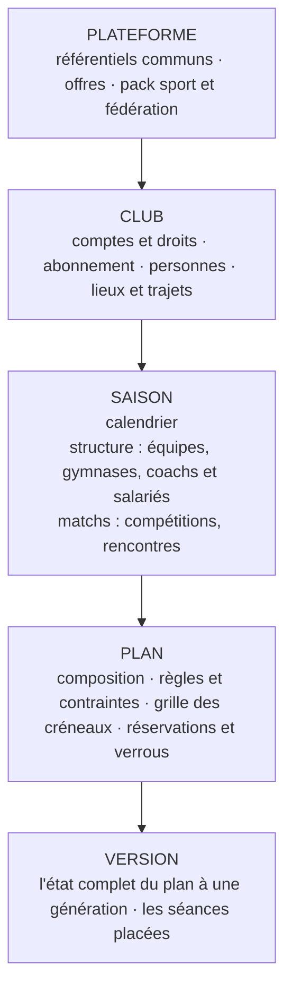
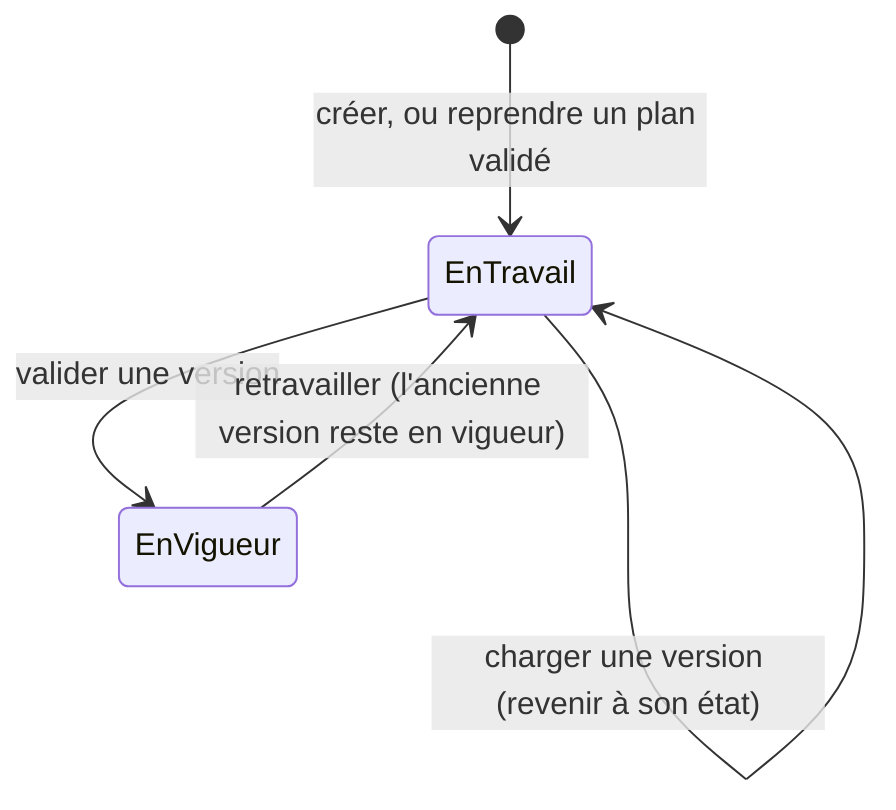

# Conception cible d'Amateo : la hiérarchie et « qui porte quoi »

**Statut : toutes les décisions sont prises (2026-11-19 et 2026-11-20) ; à relire par le fondateur.
Rien n'est codé, rien n'est découpé.** Le découpage en lots attend son go explicite. Constats de départ :
[`specs/audit/CONCEPTION-2026-11-19-claude-fable-5-2.md`](../audit/CONCEPTION-2026-11-19-claude-fable-5-2.md).
Décisions qui fondent ce document : [`lot-conception.md`](lot-conception.md).
Ce qui est rangé à plusieurs endroits aujourd'hui, et ce que cette cible en règle :
[`specs/audit/EPARPILLEMENT-2026-11-20-claude-fable-5-2.md`](../audit/EPARPILLEMENT-2026-11-20-claude-fable-5-2.md).

Ce document décrit le **modèle**, pas sa réalisation : comment les tables sont faites et dans quel
ordre on migre se décide au découpage.

## Sommaire

| Partie | Sections |
|---|---|
| A · Les fondements | 1. Les principes · 2. La hiérarchie · 3. Qui porte quoi · 4. Froid et libre · 5. Froid et libre : les cas tranchés |
| B · La plateforme et le club | 6. Le niveau plateforme · 7. Abonnement et paiement · 8. Droits, modules et crédits · 9. Comptes, rôles et personnes · 10. La démonstration et l'horloge simulée |
| C · La saison et sa structure | 11. Le temps et le calendrier · 12. Les équipes et leurs groupes · 13. Le gymnase, le lieu et les trajets |
| D · Les plans | 14. La vie d'un plan · 15. « Charger » et « Préparer la saison suivante » · 16. Doléances des coachs |
| E · Les matchs | 17. Matchs et entraînement : une seule porte · 18. La compétition |
| F · Le transverse | 19. Les écrans · 20. Les données de l'écran · 21. Les exports · 22. Les imports · 23. Ce qu'Amateo signale · 24. Le moteur et la console d'administration · 25. La frontière du sport |
| G · La réalisation | 26. La base de données · 27. Les clubs réels à convertir · 28. Effet sur les ADR · 29. Ce que ça prépare, sans le traiter |

---

**Partie A · Les fondements**

## 1. Les principes

1. **La structure du club est « équipes + gymnases + coachs et salariés ».** Elle appartient à la
   saison ; l'identité d'une personne et d'un lieu appartient au club.
2. **Les règles, les contraintes et la grille des créneaux appartiennent au plan.** Le socle est un
   plan comme les autres.
3. **Le socle est froid.** Travailler dans un plan n'affecte rien d'autre tant qu'il n'est pas
   validé. Valider le socle, c'est dire « la structure a changé » ; le reste de l'application copie
   à partir de là.
4. **Deux sortes d'informations.** Celles qui **décident du planning** sont froides. Celles qui
   **accompagnent** (un nom, un téléphone, un adjoint) sont libres : effet immédiat, rien de détruit.
5. **Une information a un seul porteur**, et ce qui doit suivre un objet (copie, photo, purge) est
   déclaré une fois. Rien n'est éparpillé : une même information vit à un seul endroit, sauf si la
   conception impose autre chose, et alors la raison est écrite (fondateur, 2026-11-20). Exemple à
   ne pas refaire : trois tables de journal de rappel, une par fonction, pour la même information.
6. **Le reste de l'application lit ce qui est en vigueur par une seule porte** : « quelle structure
   et quel planning valent à telle date ».
7. **Le générique ne dépend jamais du sport.** Tout ce qui est propre au basket et à sa fédération
   vit dans un pack à part.

Deux principes posés en cours de route s'y ajoutent : ce qui est partagé entre clubs ne dit
jamais qui l'a écrit (§6) ; sur les matchs, Amateo avertit et le gestionnaire décide (§17).

## 2. La hiérarchie



| Niveau | Ce qu'il porte | Durée de vie |
|---|---|---|
| **Plateforme** | Vacances scolaires, jours fériés, offres ; pack sport (catégories, niveaux, fédération) | Permanent |
| **Club** | Comptes et droits d'accès ; l'abonnement de chaque saison ; **personnes** (nom, contact) ; **lieux** (adresse, coordonnées) et temps de trajet entre eux | Traverse les saisons |
| **Saison** | L'année sportive ; le calendrier (fermetures, vacances) ; la **structure** ; les **matchs** | Une année |
| **Plan** | Sa **composition** (quelles équipes, combien de séances, quels gymnases, quel coach principal) ; ses **règles** ; sa **grille** ; ses **réservations** | Tant que le plan existe |
| **Version** | Une **copie complète de l'état du plan** au moment de la génération, et les séances placées | Tant qu'on la garde |

## 3. Qui porte quoi

| Information | Aujourd'hui | Cible | Sorte |
|---|---|---|---|
| Nom, e-mail, téléphone d'une personne | Sur le coach, recopiés chaque saison | **Personne**, au club | Libre |
| Rôle coach, rôle salarié | Le coach est la personne ; salarié = une case | **Rôle** d'une personne, à la saison | Libre, statut salarié compris |
| Adresse, coordonnées d'un lieu | Sur le gymnase, recopiés chaque saison | **Lieu**, au club | Libre |
| Nom, couleur d'un gymnase | Gymnase de saison | Gymnase de saison | Libre |
| Nom d'une équipe | Équipe de saison ; part au moteur et entre dans l'empreinte | Équipe de saison | **Libre** |
| Catégorie, niveau, genre, rang de priorité d'une équipe | Équipe de saison | Équipe de saison | Froid (le niveau est protégé si l'équipe est engagée en compétition) |
| Adjoints d'une équipe | Lien équipe-coach, dans l'empreinte | Structure de saison | **Libre** |
| Existence d'une équipe dans le planning, nombre de séances | Équipe de saison + surcharges de période | **Composition du plan** | Froid |
| Coach principal d'une équipe | Lien équipe-coach de saison | **Composition du socle** ; les plans de période le reçoivent du socle | Froid |
| Gymnases utilisés, grille des créneaux | Saison pour le socle, copie pour une période | **Plan**, pour tous | Froid |
| Règles et contraintes (indisponibilités comprises) | Saison, surchargées par exception en période | **Plan**, pour tous | Froid |
| Réservations, verrous, mutualisations | Plan (socle = « pas de plan ») | **Plan**, pour tous | Froid |
| Passerelles entre équipes | Saison | **Plan** : une règle du socle (§12) | Froid |
| Temps de trajet entre deux lieux | Saison, recopié chaque année | **Club** (§13) | Libre |
| Règle de trajet (cran, battement) | Saison | **Plan** (§13) | Froid |
| Occupations de gymnase (information) | Saison, copie par plan | Plan | Libre |
| Séances placées, diagnostics | Version | Version | — |
| Compétitions, rencontres | Saison | Saison | Hors planning |

## 4. Froid et libre

**Froid** = décide du placement. Se modifie en travaillant un plan ; ne vaut pour le reste de
l'application qu'à la validation.
**Libre** = accompagne. Se modifie dans la structure du club, à tout moment ; vaut tout de suite et
partout ; ne rend aucun planning caduc.

Deux exemples du fondateur, qui font foi :
- ajouter 4 adjoints : libre. Ils apparaissent partout, le socle validé reste validé ;
- renommer « SM1 » en « SM 1 » : libre. Aucune régénération, aucune destruction.

**Règle technique** : chaque information est déclarée une fois comme froide ou libre.
- L'empreinte qui dit « ce planning ne correspond plus à sa structure » ne porte que sur le froid.
  Aujourd'hui elle porte sur tout ce qui part au moteur, nom d'équipe et adjoints compris.
- La copie d'état d'une version ne contient que le froid. Charger une version ne ramène donc pas un
  ancien nom ni un ancien téléphone.
- Tout se désigne par identifiant, jamais par nom. Ce qui se calcule aujourd'hui à partir d'un nom
  (rapprochement FBI, étiquettes : à vérifier) doit se fonder sur l'identifiant.

**À l'écran, la différence ne se montre pas** (fondateur, 2026-11-19, §14) : le gestionnaire voit la
structure du club et les plans ; il découvre les conséquences au moment d'un geste impactant.

## 5. Froid et libre : les cas tranchés

1. **Le statut « salarié » : tranché, libre** (fondateur, 2026-11-19). C'est une option de la
   personne : la cocher ou la décocher ne reconstruit rien et ne périme aucun planning. Le moteur
   la lit comme un souhait qui ne bloque jamais (`ScheduleConstraintBuilder.php:1485`,
   `engine/app/solver/constraints/wellness/salarie.py:42-71`) : la prochaine génération prend la
   nouvelle valeur, les plannings déjà faits restent tels quels. Même famille que les adjoints.
2. **Le coach principal d'une équipe : tranché, froid, dans le socle** (fondateur, 2026-11-19).
   Changer de coach change l'organisation, les entraînements, les conflits et les dérogations : ça
   passe par le travail du socle et ne vaut qu'à sa validation. Les plans de période le reçoivent
   du socle, sans pouvoir en choisir un autre, comme aujourd'hui (un plan de période ne règle que
   la participation, le nombre de séances et le plafond par jour, `TeamPeriodOverride.php:56-65`).
   Coût assumé : changer de coach en cours de saison, c'est valider un socle changé, donc détruire
   les plans de période pas encore commencés (option A).
3. **Suppressions** : tranché (§14). Équipe, gymnase, coach : suppression forte avec alerte ; le
   niveau d'une équipe engagée reste figé ; les matchs d'un gymnase supprimé redeviennent « à
   placer ».
4. **Validation d'un socle changé** : les plans de période futurs sont détruits (option A) ; dans
   ce qui survit (plan de période en cours, matchs), ce qui a été retiré du socle est retiré aussi.
   Confirmé par le fondateur (2026-11-19).
5. **Écran** : tranché (§14). On ne montre pas la différence entre libre et froid ; une information
   froide se modifie sur l'écran de structure ou dans le socle, avec le même effet à la validation.

Tranché : les anciennes versions ne sont plus chargeables (§26).

---

**Partie B · La plateforme et le club**

## 6. Le niveau plateforme

Décidé avec le fondateur le 2026-11-20. Aucune table ne bouge : on écrit ce qui vit au-dessus des
clubs, et la règle de ce qui se partage.

| Famille | Contenu | Qui écrit |
|---|---|---|
| Identités | Comptes, administrateurs de la plateforme, jetons | Les personnes elles-mêmes |
| Commerce et exploitation | Offres et paliers (§7), demandes de création de club, nouveautés, déploiements | L'éditeur |
| Références publiques | Vacances scolaires, jours fériés, sports, niveaux de priorité, catalogue des fenêtres de ligue, comités et ligues de la fédération | La plateforme, depuis des sources officielles |
| Partagé entre clubs | Annuaire des adversaires, gymnases connus d'un adversaire, date limite d'engagement d'une compétition | Les clubs, pour les autres clubs |

Catalogue des ligues, comités et ligues, annuaire et gymnases des adversaires sont propres au
basket et à sa fédération : ils relèvent du pack sport (§25), pas du générique.

**Principe de partage entre clubs** (déjà écrit dans le code et gardé par des tests ;
`OpponentDirectoryEntry.php`, `OpponentVenueSuggestion.php`, `SharedCompetitionDeadline.php`,
en-têtes) : ce qui est partagé entre clubs ne dit jamais qui l'a écrit (« un compte, jamais un
qui »), ne contient que des données publiques, jamais de texte libre saisi par un club, et toute
donnée ajoutée repasse par une revue de sécurité.

## 7. Abonnement et paiement

Décidé avec le fondateur le 2026-11-20. Personne ne paie dans l'application aujourd'hui ; la
conception fait la place, elle ne construit ni écran de paiement, ni facture, ni prestataire.

Aujourd'hui : cinq offres enregistrées (Découverte, Essentiel, Club, Grand club, Bêta ;
`specs/courantes/etat-des-lieux.md` §1.11), dont trois payantes qui ne diffèrent que par le plafond
d'équipes. L'abonnement tient en deux champs sur le club, l'offre et la dernière saison réglée
(`Club.php:51-56`, `:105-117`) : aucun historique, aucune trace de qui a marqué la saison payée, nulle
part où accrocher un règlement.

1. **Un abonnement de saison est un objet** : une ligne par club et par saison, avec l'offre, le
   palier, l'état (réglé ou non), la date et l'origine (support aujourd'hui, paiement en ligne
   demain). L'offre effective se lit sur cette ligne ; les deux champs du club disparaissent. Le
   paiement en ligne écrira la même ligne.
2. **Une seule offre payante, à paliers** : 20 équipes, 34 équipes, illimité. Essentiel, Club et
   Grand club deviennent trois paliers de la même offre. Découverte et Bêta restent deux offres à
   part.
3. **Le palier a une place pour son prix, vide aujourd'hui** ; l'écran continue de dire « sur
   demande ».
4. **Un club qui a plus d'équipes que son palier n'a plus de sorties** : ni génération, ni
   placement, ni export, tant qu'il n'a pas fait son ménage ou changé de palier. Le message dit
   combien il a d'équipes et combien son palier en permet. La recopie de saison n'est pas bloquée.

Sur le point 4, état du code : la création d'une équipe au-delà du plafond est refusée à la main et
aux trois imports (`TeamStateProcessor.php:274-277`, `ParcImportExecutor.php:780-799`,
`FfbbExcelImporter.php:173-177`, `FfbbTeamImporter.php:113`), mais « Préparer la saison suivante »
et « Charger » créent des équipes sans lire le plafond. Exemple : 30 équipes au palier illimité,
renouvellement au palier 20, la recopie donne 30 équipes.

Inchangé : un club qui ne règle pas retombe en Découverte (équipes non plafonnées, sorties bridées
par les crédits) et ne peut pas passer à la saison suivante.

## 8. Droits, modules et crédits

Décidé avec le fondateur le 2026-11-20. Constats : audit de conception §R5.

Aujourd'hui « a-t-on le droit ? » se pose de cinq façons à des endroits différents : le rôle (un
défaut commun pour les écritures d'API, un appel à la main dans 46 contrôleurs), l'état (« socle
validé », appel à la main dans 17 fichiers), l'offre (un seul service, `PlanEntitlements.php:71-104`,
propre), les crédits (deux listes de noms de routes qui divergent,
`CreditBudgetSubscriber.php:44-72`), la date (1er mai, à l'écran seulement).

1. **Un module est un objet déclaré.** Planning, matchs, et demain salariés ou essai. Chaque
   fonction de l'application dit une fois à quel module elle appartient, si elle lit ou écrit, et
   si elle produit une sortie qui coûte un crédit. Chaque module dit une fois sa condition
   d'ouverture (exemple : socle validé). Un seul contrôle lit ces déclarations ; les listes de
   routes et les appels à la main disparaissent.
2. **Une offre peut ouvrir ou fermer des modules : la place existe, elle ne sert pas aujourd'hui.**
   Toutes les offres donnent tous les modules ; seule la taille change. La liste de fonctions que
   l'offre porte déjà et que rien ne lit devient la liste des modules de l'offre.
3. **Une seule règle pour le crédit** : toute sortie produite par le moteur ou par un export
   consomme un crédit, au moment où elle est obtenue. Elle couvre la génération, le comblement, le
   placement des matchs, le PDF, le tableur et la liste des matchs.
4. **Ce qu'on ne construit pas** : pas de droits configurables par club, pas de rôle en plus de
   gestionnaire et Membre.

Le service qui calcule l'offre effective d'un club reste tel quel.

## 9. Comptes, rôles et personnes

Décidé avec le fondateur le 2026-11-20.

Aujourd'hui : le compte (quelqu'un qui se connecte, niveau plateforme, un mail unique, plusieurs
clubs possibles) et le coach (quelqu'un que le club planifie, niveau club et saison) n'ont aucun
lien. Deux rôles se donnent, gestionnaire et Membre (`ClubRole.php:8-24`), mais la colonne est un
texte libre et trois anciennes valeurs restent lisibles (`ClubUserRepository.php:17-22`). Rien
n'est prévu pour effacer un coach en tant que personne : il existe une fois par saison, et son nom
figure dans les photos de versions.

1. **Compte et personne restent deux notions sans lien.** Le compte se connecte ; la personne est
   planifiée. Aucun coach ne se connecte aujourd'hui (les doléances passent par un lien public). Le
   modèle doit permettre d'ajouter plus tard un lien facultatif de la personne vers un compte, sans
   refonte ; on ne le construit pas.
2. **Deux rôles, et seulement deux** : gestionnaire et Membre. Les anciennes valeurs sont
   converties et la colonne est fermée sur ces deux valeurs.
3. **Une personne n'est jamais partagée entre deux clubs.** Un coach qui entraîne dans deux clubs
   est deux personnes. Le compte, lui, reste commun à plusieurs clubs.
4. **Effacer une personne l'anonymise.** Un seul geste, au club : l'identité disparaît partout.
   Elle est retirée des plans en cours et à venir (suppression forte, §14) ; ses séances des saisons
   archivées restent, avec la mention « personne supprimée ». Même patron que l'effacement d'un
   compte (`AccountErasureService.php`, en-tête). Possible parce que la personne vit une seule fois,
   au club, et qu'une version ne garde que le froid, donc pas les noms.

## 10. La démonstration et l'horloge simulée

Décidé avec le fondateur le 2026-11-20.

Un club de démonstration est un club normal avec une marque « démo » ; un compte de démonstration
a une fenêtre de connexion. L'horloge simulée n'est permise qu'à un club de démonstration
(`ClubClock.php:117`) ; son foyer unique est conservé. Les règles propres à la démonstration sont
écrites une par une dans 19 fichiers.

**Le régime de démonstration se déclare une fois**, et le contrôle unique des droits (§8) le lit.
Il dit trois familles de règles :

- tout est ouvert : ni crédit, ni plafond, ni paiement (`SeasonTransitionService.php:90-92`) ;
- rien ne sort vers un tiers : aucun mail à un coach, aucune invitation, aucun lien de doléance
  (`ConflictCoachMailController.php:201-202`) ;
- le compte est protégé : il ne se supprime pas, et sa fenêtre se juge sur l'heure réelle
  (`DeleteAccountController.php:45-47`).

Chaque fonction qui envoie quelque chose à un tiers le déclare, au même endroit que son module et
son crédit : elle est refusée en démonstration sans ligne de code à part.

La démonstration et l'horloge simulée sont sur la liste des sujets à revue de sécurité
obligatoire : ce rangement y passe au moment de le construire.

À ne pas confondre : la démonstration est un club fictif pour un rendez-vous ; le planning d'essai
est un planning de test dans un vrai club.

---

**Partie C · La saison et sa structure**

## 11. Le temps et le calendrier

Décidé avec le fondateur le 2026-11-20.

Solide et conservé : l'entrée de calendrier dit le fait (« vacances de Noël »), le plan dit la
réponse du club ; la zone scolaire appartient au club (`Club.php:78`) ; l'horloge.

1. **Une seule façon d'écrire un créneau de semaine** : le jour compte de 1 (lundi) à 7, avec un
   début et une durée ; chevauchement et conversions vivent à un seul endroit. Aujourd'hui le jour
   a deux numérotations (0 à 6 et 1 à 7) et les calculs sont réécrits (relevé d'éparpillement,
   sujets B5 et C1).
2. **Le comportement d'un plan se lit sur le plan, jamais dans le calendrier.** Le calendrier dit
   seulement le fait. Le plan porte sa nature, écrite une fois à sa naissance. Aujourd'hui la
   nature est écrite sur l'entrée de calendrier et recopiée sur le plan
   (`SchedulePlanProvisioner.php:1094-1100`), et une dizaine d'endroits lisent le calendrier pour
   décider du comportement d'un plan (exemple : `PeriodConstraintSelector.php:67`, `:124`).
   Nécessaire pour un plan sans date (variante de semaine, essai), qui n'a pas d'entrée de
   calendrier.
3. **Les jours fériés restent un simple affichage** : ils ne pèsent sur aucun planning
   d'entraînement ; le gestionnaire pose une fermeture s'il veut fermer.

Contrainte pour le cadrage de la variante de semaine : la semaine A et B existe déjà pour les
matchs (le club dit que ses week-ends alternent, une habitude de match porte A ou B, sans effet sur
le placement). La variante de semaine d'entraînement reprend cette notion ; elle n'en crée pas une
seconde.

## 12. Les équipes et leurs groupes

Décidé avec le fondateur le 2026-11-20.

Quatre mécanismes disent « ces équipes vont ensemble » et restent distincts : la passerelle (deux
équipes qui partagent des joueurs ou un coach), la mutualisation (plusieurs équipes sur le même
créneau), l'entente entre clubs (un repère, sans effet), la demande de mutualisation d'un coach (un
souhait).

1. **La passerelle est une règle du plan** : elle appartient au socle, elle est froide, et les
   matchs lisent celle qui est en vigueur. Elle revient avec « Charger » et elle est recopiée à la
   saison suivante avec les réglages du socle.
2. **Ce que porte une équipe, et où** :

   | Information | Où | Libre ou froid |
   |---|---|---|
   | Nom, entente entre clubs | L'équipe, dans la structure | Libre |
   | Catégorie, niveau, sexe, rang de priorité | L'équipe, dans la structure | Froid |
   | Nombre de séances, plafond par jour, participation | Le plan | Froid |
   | Jour de match habituel | Le module matchs | À chaud |
   | Gymnase imposé | Une règle du plan | Froid |

3. **Les étiquettes se calculent à la lecture**, à partir de la catégorie, du niveau et du sexe de
   l'équipe. Les deux tables d'étiquettes et leur resynchronisation disparaissent. Aujourd'hui
   toutes les étiquettes sont déjà calculées (aucun écran n'en crée de libre), mais enregistrées,
   et le calcul « étiquette vers équipes » existe côté serveur et en miroir côté écran
   (`TeamTagResolver.php:14-18`, `:47-50`). Un groupe libre d'équipes n'est pas un besoin ; il
   demanderait de recréer un endroit pour le ranger.

## 13. Le gymnase, le lieu et les trajets

Décidé avec le fondateur le 2026-11-20. Rappel de ce qui précède : le lieu vit au club, le gymnase
de la saison est l'usage qu'on en fait cette année (§2, §3) ; la grille et les occupations
appartiennent au plan ; les ouvertures aux matchs appartiennent au module matchs (§18) ; supprimer
un gymnase est une suppression forte (§14).

1. **La règle des gestes vaut pour les gymnases** : dans un plan, on coche les gymnases qui
   participent ; on ne supprime un gymnase que dans la structure. Aujourd'hui la case « actif » est
   sur le gymnase pour le socle (`Venue.php:74`) et dans une ligne d'exception pour une période.
2. **Libre et froid sur un gymnase** : le nom, la couleur et l'adresse sont libres ; « divisible en
   deux » est froid, parce qu'il change le nombre d'équipes qu'on peut y placer.
3. **Les temps de trajet** : le temps entre deux lieux est un fait, il vit au club, une fois, et
   n'est plus recopié chaque saison ; c'est une information libre (le corriger ne périme aucun
   planning, la génération suivante prend la nouvelle valeur). La règle de trajet (obligatoire,
   préférée ou inactive, battement toléré) est un choix : elle appartient au plan, comme les autres
   règles. Aujourd'hui le barème est rangé par saison (`VenueTravelTime.php:57-83`) alors que le
   trajet calculé est déjà rangé au club (`ClubTravelCache.php`, en-tête). Limite assumée : avec
   une règle « obligatoire », un planning déjà validé peut ne plus la respecter après une
   correction de temps, sans signalement.

Le lieu n'a pas de type : un gymnase est un lieu où l'on s'entraîne. Un bureau ou une salle de
réunion sera un lieu de plus, sans refonte. Aucun type de lieu n'est construit.

---

**Partie D · Les plans**

## 14. La vie d'un plan



- **En travail** : l'état que le gestionnaire modifie. Invisible du reste de l'application.
- **Version** : chaque génération fige une copie **complète** de l'état de travail (composition,
  règles, grille, réservations) avec les séances obtenues.
- **En vigueur** : la version validée. C'est elle que lisent les matchs, le radar et les plans de
  période. Pour le socle, sa composition **est** la structure en vigueur du club.
- **Retravailler ne détruit rien** : la version en vigueur le reste jusqu'à la validation suivante.

- **Valider supprime les autres versions du plan** (règle actuelle, maintenue) : un plan validé est
  la fin du travail, les essais non retenus ne sont pas gardés. « Charger » ne sert donc que
  pendant le travail, entre deux validations.

### Deux portes pour modifier (fondateur, 2026-11-19)

| Porte | Ce qu'on y modifie | Quand ça vaut | Propagation |
|---|---|---|---|
| **La structure du club**, directement | Les informations libres (nom, contact, adjoints) ; **supprimer** une équipe, un gymnase ou un coach (l'objet lui-même cesse d'exister dans le club) | Tout de suite | Partout, immédiatement ; une suppression retire l'objet de tous les plans, après alerte et « supprimer » en toutes lettres. Une information froide modifiée ici suit la ligne du dessous : elle vaut à la validation du socle |
| **Le planning du socle** | Le froid : retirer ou ajouter une équipe au planning, ses séances, la grille, les règles | À la validation | À la validation, le changement vaut partout : une équipe retirée du socle n'est plus prise en compte nulle part |

**Règle des gestes (confirmée par le fondateur, 2026-11-19) : dans un plan, on ne supprime jamais
rien, on choisit ce qui participe ; supprimer se fait dans la structure.** Tous les plans suivent
la même règle, socle compris.

| Geste | Où | Effet |
|---|---|---|
| Cocher ou décocher une équipe | Dans un plan (le socle reprend la case qui existe pour les périodes) | Elle participe ou non à ce plan ; elle existe toujours dans le club, avec ses matchs. Pour le socle, effet à la validation |
| Supprimer une équipe | Dans la structure du club, seulement | Elle cesse d'exister ; effet immédiat, partout, plans et matchs compris |

Cas réel qui justifie la distinction : une équipe de pôle qui s'entraîne avec le pôle, donc sans
aucune séance au club, mais qui joue ses matchs sous le nom du club. Aujourd'hui le socle n'a pas
de case à cocher : la seule façon de sortir une équipe du planning est de la supprimer du club.

**Supprimer une équipe qui a des matchs (fondateur, 2026-11-19) : permis, par une suppression
forte.** L'écran alerte (l'équipe joue, ses matchs partent avec elle, liste de l'impact), puis le
gestionnaire écrit « supprimer » en toutes lettres pour confirmer. Raison : Amateo ne connaît pas
la réalité de chaque club (forfait général, équipe retirée par la fédération) ; il prévient, il
n'interdit pas.

- Aujourd'hui c'est refusé : un seul match, même non placé, rend l'équipe indélébile
  (`TeamEngagementGuard.php:49-63`, `TeamStateProcessor.php:63-65`). Le filet existe déjà : la
  cascade emporte les matchs et les engagements en compétition de l'équipe
  (`CascadePlan.php:70-76`).
- Ce que ça change : l'axe « périmètre engagé » (ni suppression ni changement de niveau) perd sa
  moitié « suppression ». Le **niveau figé** d'une équipe engagée n'est pas touché par cette
  décision.
- Conséquence à connaître : FBI connaît toujours ces matchs. Au prochain import, leur division
  revient « sans correspondance » : ni créée, ni en erreur, proposée à l'étape de correspondance
  (`FbiFixtureImporter.php:70-71`).

**Même suppression forte pour un gymnase et pour un coach (fondateur, 2026-11-19).** On ne supprime
pas facilement ce qui a été validé et utilisé dans l'application : l'écran alerte en disant ce que
la suppression coûte, puis exige « supprimer » en toutes lettres. Le **niveau** d'une équipe
engagée, lui, **reste figé**.

- Aujourd'hui : un gymnase qui accueille des matchs placés est indélébile, il faut d'abord retirer
  les matchs (`DeletionImpactCounter.php:59-73`) ; un coach se supprime sans blocage
  (`DeletionImpactCounter.php:80-87`).
- Les matchs placés dans un gymnase supprimé **redeviennent « à placer »** ; l'alerte en donne le
  nombre (fondateur, 2026-11-19). Ils appartiennent à leur équipe, pas à la salle : aucun ne
  disparaît. Un match déjà déclaré dans FBI avec cette salle se retrouve en écart avec FBI.

**Une information froide se modifie à deux endroits, au choix (fondateur, 2026-11-19) : sur
l'écran de structure, ou dans le socle.** Changer le coach principal d'une équipe ou ajouter une
équipe se fait là où le gestionnaire en a l'habitude. Les deux entrées mènent au même état de
travail : le changement vaut à la validation du socle, et l'application l'annonce au moment du
geste.

**Ce que voit le gestionnaire (fondateur, 2026-11-19) : la structure du club et les plans, rien
d'autre.** Froid et libre sont une notion des données, pas de l'écran : aucun libellé, aucune
couleur ne les distingue. Le gestionnaire pose ses équipes, ses gymnases, ses coachs, puis
travaille son planning, comme aujourd'hui. Il ne découvre la différence qu'au moment d'un geste
qui a des conséquences : là, l'application les annonce. Changer son club n'est pas un geste
courant, et il doit sentir que ça pèse.

### À la création d'un club, et à chaque nouvelle saison

Tant qu'aucun socle n'est validé, **il n'y a pas de structure en vigueur : le plan fait foi**
(fondateur, 2026-11-19). Le Wizard saisit alors d'un même geste les objets du club et leur
participation au socle ; rien d'autre ne les lit, puisque les matchs et les plans de période
n'ouvrent qu'avec un socle validé. La première validation fait naître la structure en vigueur.
Ce n'est pas une exception : c'est la règle « le socle est froid » appliquée à la première fois.

Précision de réalisation : une équipe, un gymnase ou un coach reçoit son identifiant dès sa
saisie et le garde ; la validation change ce qui est en vigueur, elle ne recopie pas les objets.
Sinon les règles, les verrous et les séances posés avant la validation perdraient leur cible.

### Valider le socle : l'effet destructeur

| Geste | Effet sur les plans de période pas encore commencés |
|---|---|
| Modifier une information libre | Aucun |
| Retravailler le socle, générer, charger | Aucun |
| Valider un socle dont rien de froid n'a changé | Aucun |
| Valider un socle dont quelque chose de froid a changé | **Détruits**, après affichage de la liste (option A, décision du fondateur) |

Passage possible plus tard au cas par cas (seuls les plans touchés par le changement) si l'usage le
demande. Un plan de période **déjà commencé** n'est pas détruit, comme aujourd'hui ; mais ce qui a
été retiré du socle (une équipe, un gymnase) en est retiré aussi, pour ne plus être pris en compte
nulle part (confirmé par le fondateur, §5).

À la validation, les matchs concernés sont annoncés aussi (gymnase disparu, créneau désormais pris
par un entraînement) : c'est déjà le comportement actuel, il devient la règle générale.

## 15. « Charger » et « Préparer la saison suivante »

### Charger une version

**Une seule définition, pour tous les plans** : remettre l'état de travail du plan tel qu'il était
à la génération de cette version, au complet (composition, règles, grille, réservations,
passerelles, mutualisations, séances).

Exemple du fondateur (2026-11-19) : le plan en est à la version 3 ; charger la version 1 redonne
exactement l'état « je viens de générer la version 1 », avec ses passerelles, ses contraintes et
ses mutualisations.

- **Une version ne touche que le plan** (fondateur, 2026-11-19) : charger restaure l'état du plan,
  rien d'autre ; aucun effet sur la saison ni sur la structure. Les catégories du club ne sont donc
  jamais effacées par un chargement (elles le sont aujourd'hui, `StructureRestorer.php:274`, à
  vérifier).
- Ne touche jamais à ce qui est en vigueur : c'est l'état de travail qui change.
- Ne ramène pas les informations libres (noms, contacts, adjoints).
- Aucun trou : tout le froid du plan est dans la copie, parce que la liste de ce qui est copié est
  déclarée une seule fois (§26).

Aujourd'hui, le même mot fait deux choses (sur le socle : effacer la configuration du club et la
remplacer par une photo incomplète ; sur une période : désigner la version dont on garde les
verrous), et les passerelles, les trajets, les règles du club et les mutualisations ne sont pas
restaurés.

### Préparer la saison suivante

**Tout est repris comme contexte de départ** ; le gestionnaire fait son ménage ensuite.

| Quoi | Ce qui se passe |
|---|---|
| Personnes, lieux, temps de trajet entre lieux | Restent : ils sont au club |
| Équipes, rôles de coach et de salarié, gymnases de saison, adjoints | Recopiés dans la nouvelle saison |
| Réglages du socle en vigueur (composition, règles dont les passerelles, grille, réservations) | Recopiés comme état de travail du nouveau socle |
| Entente entre clubs d'une équipe, mutualisations du socle | **Non**, voulu (fondateur, 2026-11-19) : rien ne garantit qu'une entente dure la saison suivante. Comportement actuel conservé |
| Le planning (séances) | **Non** : il se génère dans la nouvelle saison |
| Matchs, compétitions | Non |

Ce qui est recopié vient de la même déclaration unique que pour Charger.

## 16. Doléances des coachs

Décidé avec le fondateur le 2026-11-20.

1. **Le principe reste** : une doléance est un souhait, jamais une règle ; elle est attachée aux
   vacances et à une semaine, jamais à un plan ; seul le geste « Transférer au planning » du
   gestionnaire la convertit en réglages du plan (`CoachWish.php`, `CoachWishTransferService.php`,
   en-têtes).
2. **Valider un socle changé ne détruit plus les doléances ni la campagne des vacances à venir.**
   Seuls les plans de période sont détruits. Une doléance reçue avant le changement porte la
   mention « réponse donnée avant la modification du planning de saison ». Remplace la règle
   actuelle, qui détruit campagne, doléances et demandes de mutualisation
   (`FutureHolidayCollectePurger.php`, en-tête). Raison : resolliciter des coachs qui ont déjà
   répondu coûte cher, et une doléance n'est qu'un souhait que le gestionnaire arbitre.
3. **Les doléances restent réservées aux vacances** pour l'instant. Aucune généralisation à
   d'autres périodes.

Ce que le reste de la conception change ici, sans décision de plus : le coach pointé devient une
personne du club ; le transfert écrit directement dans le plan, sans ligne d'exception ; les dates
d'envoi et de relance rejoignent le journal des envois ; le module se déclare comme une partie du
planning.

---

**Partie E · Les matchs**

## 17. Matchs et entraînement : une seule porte

Le lien existe et il est fort, mais il est calculé, pas stocké.

- Un match pointe la **structure en vigueur** : son équipe, son gymnase à domicile.
- Un match trouve le planning **par sa date** : le plan de période le plus étroit qui couvre la
  date, sinon le socle ; puis les séances de ce jour de semaine. D'où « pas de match ici, il y a un
  entraînement », au radar comme au placement.
- L'entraînement lit les matchs : jour de repos après le jour de match ; équipe engagée protégée.

**Règle cible** : les matchs passent par une seule porte, « structure et planning en vigueur à
telle date ». Ils ne lisent jamais un état de travail.

**Confirmé par le fondateur (2026-11-19) :**

- **Les matchs ne partagent rien d'autre avec l'entraînement que la structure du club et cette
  lecture.** La lecture sert à avertir : « à ce moment-là il y a peut-être un entraînement, le
  gymnase est peut-être occupé ». Trois cas, tranchés par le fondateur :
  - **Le placement automatique ne pose jamais un match sur un entraînement** : le moteur connaît
    les plages d'entraînement et les tient pour prises (déjà le cas,
    `engine/app/solver/match_placement/holding.py:14`, `:182`).
  - **Le placement à la main est permis et averti** : le gestionnaire peut passer outre, c'est sa
    responsabilité (déjà le cas).
  - **Poser une règle de match avertit aussi** (à construire) : ouvrir un gymnase aux matchs sur
    une plage où des entraînements y sont placés affiche « des entraînements sont placés dans ce
    gymnase sur cette plage ». Exemple : gymnase ouvert aux matchs de 8 h à 20 h, entraînements
    placés de 8 h à 12 h. Avertissement seulement. Aujourd'hui l'enregistrement de cette règle ne
    lit pas le planning (`VenueMatchWindowStateProcessor.php`).
  Principe : sur les matchs, Amateo avertit et le gestionnaire décide ; on ne contrôle pas tout.
- **Les matchs sont toujours à chaud.** Ni validation, ni version, ni froid : une règle de match
  modifiée vaut tout de suite. Le seul froid est celui de la structure que les matchs lisent.
  Chaque match suit son propre cycle (à placer, placé, envoyé, validé).

## 18. La compétition

Aujourd'hui tout vient de FBI. Le modèle doit pouvoir accueillir une compétition hors FBI (un club
professionnel en compétition européenne, match à domicile en semaine) sans réécrire ce qui existe.

### Le rattachement (confirmé par le fondateur, 2026-11-19)

```
SAISON
├── Structure en vigueur : équipes, gymnases, coachs
├── Plans d'entraînement : socle, périodes
└── Module matchs
    ├── COMPÉTITION   source, nature, niveau, dates, ses règles
    │   └── ENGAGEMENT   une équipe du club dans cette compétition (poule, libellé FBI)
    │       └── MATCH    date, domicile ou extérieur, adversaire, placement
    │           └── SUIVI FBI   séparé, absent pour un match hors FBI
    └── Règles du club pour les matchs : gymnases ouverts, habitudes, contraintes
```

- **Un match est rattaché à une équipe et à une compétition**, par l'engagement. Il appartient à
  la saison, jamais à un plan.
- **Compétition et engagement sont deux objets.** Aujourd'hui une « compétition » porte un
  `teamId` (`Competition.php:44-51`) : c'est l'engagement d'une seule équipe, et deux équipes dans
  le même championnat font deux compétitions. Cible : une compétition, plusieurs engagements.
- **Une équipe peut jouer plusieurs compétitions**, chacune avec ses règles, chaque match avec ses
  modalités.
- **Une nouvelle compétition se crée dans la saison**, dans le module matchs ; on y engage une ou
  plusieurs équipes.
- **Un match amical est un match d'une compétition de nature « amical », qui ne porte aucune
  règle** (fondateur, 2026-11-20 ; remplace « lié à aucune compétition » du 2026-11-19). Tout
  match a donc une équipe et une compétition, sans cas particulier. Trois conditions :
  1. « Amical » est une nature écrite sur la compétition, comme championnat, coupe et brassage ;
     posée une fois, à l'import ou à la création, jamais relue dans un libellé.
  2. Une compétition « Amicaux » existe d'office dans chaque saison : poser un amical à la main
     reste un seul geste. D'autres compétitions amicales peuvent être créées (tournoi de
     pré-saison) ; une division « Amical … » de la fédération en devient une.
  3. Les comportements propres à l'amical se lisent sur la nature, à un seul endroit : jamais
     confié au placement automatique, ne bloque rien, s'arrête à « placé » s'il ne vient pas de la
     fédération.
  Aujourd'hui l'amical a deux représentations : un match sans compétition
  (`MatchPlacementPayloadBuilder.php:464`) ou une compétition dont le libellé commence par
  « amical » (`FriendlyAutoValidator.php:25-26`, `FbiDivisionSignature.php:79`), et la nature
  « amical » n'existe pas dans la liste (`FbiDivisionSignature.php:25`).

| Règle | Portée par | S'applique à |
|---|---|---|
| Jours et heures de match, durée, échauffement | La compétition | Ses matchs seulement |
| Ouverture d'un gymnase aux matchs | Le club, sur le gymnase | Tous les matchs concernés, toute compétition |
| Habitude de match d'une équipe | Le club, sur l'équipe | Tous les matchs de l'équipe |
| Contraintes (interdictions, plages) | Le club, sur le club, une équipe, un coach ou un gymnase | Tous les matchs concernés |

Aujourd'hui la fenêtre de ligue se déduit de la catégorie, du niveau et du sexe de l'équipe
(`ClubLeagueWindow.php:54-79`), pas de la compétition : c'est ce qui empêche une équipe de jouer
deux compétitions aux règles différentes.

### Les principes

1. **Une compétition a une source** : FBI, ou saisie à la main.
2. **Une compétition porte ses règles** : jours et horaires de match, durée, échauffement. Les
   fenêtres de la ligue sont les règles par défaut d'une compétition FBI, pas une propriété de
   l'équipe. Une équipe peut jouer deux compétitions aux règles différentes.
3. **Sa nature s'écrit en champs** (championnat, coupe, brassage, amical ; niveau ; phase), posés une fois
   à l'import par un seul classifieur. Plus aucune règle déduite d'un libellé ailleurs.
4. **Le suivi FBI est séparé du match.** Un match hors FBI s'arrête à « Placé ».
5. **Plus de repli silencieux** : un club d'une ligue absente du catalogue reçoit toujours les
   règles de la ligue de référence, mais l'écran le dit (« Amateo ne connaît pas les règles de
   votre ligue ; celles affichées sont celles de la ligue X, merci de les vérifier »). Un club
   dont la ligue est au catalogue ne voit aucun avertissement (fondateur, 2026-11-19).

On fait la place dans le modèle ; l'écran de saisie d'une compétition hors FBI n'est pas construit.

---

**Partie F · Le transverse**

## 19. Les écrans

Décidé avec le fondateur le 2026-11-20.

Aujourd'hui le Wizard fait deux métiers : ses étapes 1 à 3 (équipes, gymnases, coachs) sont le
seul écran de structure, ses étapes 4 à 6 (contraintes, récapitulatif, génération) préparent le
planning ; chaque saisie vaut tout de suite dans la structure vivante
(`frontend/docs/frontend-wizard.md`). Le mode « période » a ses propres écrans d'équipes, de
gymnases et de contraintes (`PeriodTeams`, `PeriodVenues`, `PeriodConstraints`) à côté de ceux du
socle.

1. **Deux endroits à l'écran : la structure du club, et les plans.**
   - La structure du club : équipes, gymnases, personnes avec leurs contacts ; on y crée, renomme
     et supprime. La liste des coachs avec leur numéro y vit.
   - Le Wizard d'un plan : qui participe, combien de séances, la grille, les règles, le
     récapitulatif, la génération.
   - Pour un nouveau club, le parcours guidé enchaîne les deux sans couture.
   - Depuis le Wizard d'un plan, « ajouter une équipe » reste un seul geste : elle est créée dans
     la structure et cochée dans le plan.
2. **Un seul Wizard pour tous les plans** : le socle et les périodes utilisent les mêmes étapes et
   les mêmes écrans. Les écrans en double disparaissent ; le socle reçoit la case « participe ou
   non ».
3. **Un état visible « des modifications attendent la validation »** : le gestionnaire voit que
   son socle a été retravaillé et pas encore validé. À la validation, la liste de ce qui change et
   de ce qui est détruit s'affiche (§14).

Rangement de code, sans décision : la page du planning (1 876 lignes, trois usages) se traite
quand ce domaine est refondu.

## 20. Les données de l'écran

Décidé avec le fondateur le 2026-11-20.

Aujourd'hui : équipe, coach et gymnase sont déclarés à la main en trois exemplaires (Wizard,
planning, matchs), les mêmes appels au serveur sont redéclarés deux à quatre fois, la même donnée
vit sous plusieurs clés en mémoire reliées par un pont écrit à la main (audit de conception §R6 ;
relevé d'éparpillement §5, sujets C4 et C5).

**Une seule déclaration par objet, écrite à la main, partagée par tous les écrans** : sa forme, ses
appels au serveur, sa clé en mémoire. Quand un objet change, tous les écrans qui le montrent se
mettent à jour, sans liste à tenir. Pas de production automatique depuis la description de l'API :
celle-ci est en partie écrite à la main, on ne ferait que déplacer la recopie. À faire avec l'écran
de structure et le Wizard unique (§19), qui réécrivent déjà une bonne part de ces fichiers.

## 21. Les exports

Décidé avec le fondateur le 2026-11-20.

Aujourd'hui : le PDF du planning passe par une file d'attente, enregistre un état et une adresse de
téléchargement sur la version, et son fichier reste stocké jusqu'à une purge ; le tableur et le PDF
des matchs rendent le fichier dans la réponse. Les deux PDF utilisent le même outil de rendu
(`MatchesPdfGenerator.php` s'appuie sur `PdfGenerator.php`).

1. **Un seul chemin pour tout document : je demande, je reçois le fichier.** Chaque export déclare
   une fois son module, qui y a droit, son contenu et son crédit ; la fabrication, la livraison et
   le crédit pris à la livraison sont communs. Disparaissent : la file d'attente du PDF du
   planning, l'état et l'adresse d'export sur la version, le téléchargement à part, la purge des
   fichiers stockés, le champ d'export de la saison.
   **Réserve** : mesurer le temps de rendu du PDF du planning sur un grand club avant de l'acter.
   Si la mesure est mauvaise, on uniformise dans l'autre sens : tout en file.
2. **Tout Membre peut exporter**, et un export consomme un crédit du club en Découverte (comportement
   actuel conservé ; aucun des trois exports ne vérifie le rôle).
3. **Ce qui sort ou non** se lit sur la nature du plan (§11) : un planning d'essai ne sort pas.

## 22. Les imports

Décidé avec le fondateur le 2026-11-20.

Aujourd'hui six chemins font entrer des données : la fiche du club et les équipes engagées d'un
nouveau club (automatiques), les équipes depuis un fichier de la fédération, les matchs depuis le
fichier FBI, les matchs par la liaison directe avec la fédération, l'import du parc. Trois suivent
déjà le même déroulé ; la suite de contrôles à l'entrée est écrite trois fois (`TeamImportGate`,
`FixtureImportGate`, `ParcImportGate`).

1. **Un seul déroulé pour tout import** : un aperçu qui n'écrit rien, les choix du gestionnaire,
   une écriture tout ou rien, un seul contrôle à l'entrée. Chaque import déclare sa source, ce
   qu'il crée et sa condition (socle validé ou non). Exception écrite : la création automatique des
   équipes d'un nouveau club, sans aperçu (`FfbbTeamImporter.php`, en-tête).
2. **Deux positions vis-à-vis de la fédération** :
   - pour la structure du club, la fédération est une aide : tout reste modifiable, le club décide ;
   - pour les matchs, la fédération fait foi : Amateo est en retard sur elle, jamais en avance.

Ce que le reste de la conception change ici : l'import des matchs fait correspondre une division à
une compétition et à l'engagement d'une équipe, et pose la nature une fois (§18) ; l'import du parc
écrit les équipes et les gymnases dans la structure, et la grille, les mutualisations et les
réservations dans le socle en travail (§14) ; tout ce qui vient de la fédération relève du pack
sport (§25), l'import du parc est générique.

## 23. Ce qu'Amateo signale

Décidé avec le fondateur le 2026-11-20.

Aujourd'hui, trois familles et trois façons : les diagnostics d'une génération, enregistrés avec la
version (`ScheduleDiagnostic.php:37-98`) ; les conflits des matchs, recalculés à chaque affichage
(`ConflictRadarLoader.php`, en-tête) ; les écarts avec la fédération, dans un registre à part. Un
diagnostic est le constat figé d'une génération passée, un conflit de match est vivant : les
rangements restent distincts.

1. **Une seule liste des types de conflit, côté serveur** ; l'écran et la documentation de l'API la
   lisent au lieu de la recopier. Aujourd'hui elle est écrite en toutes lettres dans huit fichiers,
   la documentation de l'API en compte 12 et l'écran 14 (`frontend/src/features/matches/api/conflicts.ts:72-93`).
2. **Une forme commune pour tout ce qu'Amateo signale** : un type pris dans une liste déclarée par
   module, une gravité dans un seul vocabulaire, qui est concerné (équipe, personne, lieu) et
   quand, un message. Les trois familles gardent leur rangement. Un nouvel avertissement se
   déclare au lieu de s'inventer une forme. À faire quand chaque domaine est refondu, pas d'un
   coup.
3. **Le statut de traitement** (dérogation demandée, résolu en interne, etc. ;
   `ConflictResolution.php`, en-tête) reste réservé aux conflits des matchs. La forme commune
   permet de l'étendre plus tard sans refonte ; rien n'est construit.

## 24. Le moteur et la console d'administration

Décidé avec le fondateur le 2026-11-20.

**Console d'administration** : rien à changer. Ses actions de support et ses tâches sont déjà des
catalogues fermés, déclarés une fois (`AdminActionCatalog.php`, en-tête). Seule conséquence : les
actions « changer l'offre » et « saison réglée » écrivent la ligne d'abonnement de saison (§7).

**Moteur** : son contrat ne bouge pas pendant la refonte (§26). C'est le filet de la refonte : le
moteur reçoit exactement la même demande qu'avant.

**Principe écrit maintenant, réalisé après la refonte : une règle du moteur vit dans le moteur.**
Aujourd'hui chaque règle existe dans le moteur, dans le backend pour prévenir avant de générer
(`PreSolvePreventionWarnings.php`, 1 735 lignes, une vingtaine de règles réécrites) et parfois dans
l'écran ; une règle modifiée dans le moteur se réécrit à la main côté backend. Cible : le moteur
répond lui-même à « cette demande est-elle vouée à l'échec ? » par une vérification rapide sans
calcul de planning, et le backend affiche. Pas pendant la refonte : changer le moteur en même
temps ferait disparaître le filet. Ligne de roadmap : P4-617.

**Cible retenue pour P4-617 : « construire sans résoudre » (fondateur, 2026-11-20).** Le moteur
sépare déjà le montage du problème du calcul (`engine/app/solver/model.py:164`) et note, à la pose
de chaque règle, quel créneau elle ferme pour quelle équipe, avec l'identifiant et le libellé de la
règle (`engine/app/solver/result_builder/diagnostics/sessions.py:20-33`). La prévention avant
génération devient le montage seul, suivi de la lecture de ces fermetures : aucune règle réécrite,
ni dans le backend ni dans le moteur ; la cause affichée porte le nom de la règle du gestionnaire.
On n'écrit pas dans le moteur un jeu de vérifications à part, qui ne ferait que déplacer la
recopie. À vérifier au cadrage : combien des préventions actuelles s'y ramènent (celles qui
comparent des totaux demandent que le montage expose des comptes ; un avertissement sur
l'intention d'une règle n'en sort pas), et le temps de montage pour un grand club.

## 25. La frontière du sport

On ne construit pas un second sport. On range pour qu'un autre sport puisse reprendre les briques.

| Générique (réutilisable tel quel) | Pack sport et fédération (basket, FFBB aujourd'hui) |
|---|---|
| Club, comptes, droits | Catégories d'âge, niveaux d'équipe |
| Personnes, lieux | Durées de match et d'échauffement |
| Saison, calendrier | Source des compétitions (FBI), suivi fédéral |
| Plans, versions, validation | Fenêtres de ligue, règles fédérales |
| Solveur d'entraînement (une équipe, un lieu, un jour, une heure) | Format du code du club, annuaire des adversaires |
| Exports, envois | Vocabulaire propre au sport |

**Règle** : le générique ne dépend jamais du pack. Exemples de fuites actuelles à corriger :
l'inscription d'un club exige un code fédéral ; les niveaux d'équipe sont une liste fédérale figée
dans le cœur ; la durée d'un match se lit dans le nom de la catégorie.

---

**Partie G · La réalisation**

## 26. La base de données

Changer « qui porte quoi », c'est changer les tables.

- **Tables nouvelles** : personnes, lieux, rôles.
- **Changements de propriétaire** : règles, contraintes, grille et composition passent de la saison
  au plan ; l'identité quitte le coach et le gymnase.
- **De vraies clés étrangères** sur le nouveau schéma. Aujourd'hui il y en a 14 pour environ 90
  tables et l'intégrité est tenue par une liste écrite à la main. Avec des clés, la base refuse
  elle-même une séance qui pointe une équipe disparue.
- **Une déclaration unique par famille d'objets** : à quel niveau elle vit, si elle est froide ou
  libre, si elle se recopie à la saison suivante, si elle entre dans la copie d'une version. Les
  huit listes tenues à la main aujourd'hui la lisent, et un test signale tout objet non déclaré.
- **Données existantes** : chaque club en base est converti. **Les anciennes versions ne sont plus
  chargeables** (fondateur, 2026-11-19 : version bêta, on repart sur du propre, on ne s'encombre
  pas du passé) : les photos stockées ne sont pas converties ; seule la version validée de chaque
  plan est reprise.
- **Ce qui ne bouge pas** : le contrat avec le moteur. Le backend continue de lui envoyer les mêmes
  données ; aucun changement côté solveur.

### Ce que le relevé d'éparpillement ajoute (fondateur, 2026-11-20)

Six sujets entrent dans la conception parce qu'ils changent les tables. Preuves :
[`specs/audit/EPARPILLEMENT-2026-11-20-claude-fable-5-2.md`](../audit/EPARPILLEMENT-2026-11-20-claude-fable-5-2.md) §4.

| Sujet | Aujourd'hui | Cible |
|---|---|---|
| La forme d'une règle | Règle d'entraînement en JSON, règle de match en colonnes typées, pour la même portée et la même intensité | Une seule forme de règle ; entraînement et match restent deux familles |
| L'indisponibilité d'un coach | Trois saisies (entraînement, matchs, doléance) | Un seul porteur, lu par les trois |
| L'intensité d'une règle | Cinq vocabulaires pour dur, souple, éteint | Un seul |
| Le réglage de trajet | Sa propre table | Rangé avec les autres réglages de règles du club |
| Les règles d'une équipe | Jour de match et gymnase imposé en colonne sur l'équipe et aussi ailleurs | Un seul porteur chacun |
| La trace d'un envoi | « Ce mail est déjà parti » sous cinq formes, dont trois tables de rappel | Un seul journal des envois, qui répond à « qu'a reçu ce club, et quand » |

Comment chacun se réalise se décide au découpage. Les sept sujets de rangement de code du relevé
(§5) ne changent pas les tables : ils se traitent au fil des domaines refondus.

## 27. Les clubs réels à convertir

Décidé avec le fondateur le 2026-11-20. Rappel (§26) : chaque club en base est converti ; les
anciennes versions ne sont pas reprises, seule la version validée de chaque plan l'est.

**État de la production, mesuré en lecture seule le 2026-11-20** (clubs de démonstration exclus ;
comptes seulement) :

| Mesure | Résultat | Ce que ça veut dire pour la conversion |
|---|---|---|
| Clubs réels, saisons | 4 clubs, 1 saison chacun, toutes actives ; plus ancienne création le 2026-10-02 | Aucune saison archivée à convertir |
| Coachs | 52 ; aucun en double, ni d'une saison à l'autre ni dans la même | Une personne par coach, sans fusion |
| Coach dont le mail est celui d'un compte du club | 0 | Compte et personne sans lien (§9) ne crée aucun doublon aujourd'hui |
| Gymnases | 18 ; aucun en double | Un lieu par gymnase, sans fusion |
| Compétitions | 150 lignes ; aucun groupe à réunir par identifiant fédéral ; 130 sans identifiant fédéral | Chaque ligne devient une compétition avec un engagement ; rien à regrouper |
| Compétitions au nom « amical… » | 5 | Nature amicale à poser |
| Matchs | 677 ; aucun sans compétition | Rien à verser dans la compétition « Amicaux » d'office |
| Plans | 10 (4 de saison, 6 de période) ; au plus 1 version par plan, 9 versions en tout | « Anciennes versions non reprises » ne fait rien perdre |
| Plans de période en cours ou à venir | 0 | La preuve par la demande au moteur porte sur les socles |
| Rôles | Une seule valeur, gestionnaire ; aucun Membre | Rien à convertir |
| Offres | 3 clubs en Bêta, 1 en Découverte ; aucun plafond d'équipes atteignable | 4 lignes d'abonnement à créer |
| Lignes d'exception de période | 274 (équipes), 129 (contraintes), 26 (gymnases) | À verser dans les 6 plans de période |
| Étiquettes | 96 et 411 affectations | Supprimées |
| Photos de structure | 2 | Supprimées |
| Doléances | 1 campagne, 36 doléances, 29 liens | À rattacher aux personnes |

Champs supposés sans usage, confirmés vides en production : mémo fédéral d'un match (0 sur 677),
plancher de séances d'une équipe (0 sur 94), jour de match en colonne sur l'équipe (0 ; 32 équipes
passent par une habitude de match), sexe d'une catégorie (0 sur 49), types de période autres que
vacances et fermeture (0). Non lisibles avec le rôle de lecture : la table des conflits entre
contraintes et les trois journaux de rappel.

| Avant | Après |
|---|---|
| Un coach par saison | Une personne au club, avec ses rôles |
| Un gymnase par saison | Un lieu au club |
| Grille, règles, réservations sur la saison | Dans le socle |
| Une compétition par équipe | Une compétition, un engagement par équipe |
| Amical = match sans compétition, ou libellé « amical » | Compétition de nature amicale |
| Offre et dernière saison réglée sur le club | Une ligne d'abonnement par saison |
| Anciens rôles en texte libre | Gestionnaire ou Membre |
| Étiquettes, lignes d'exception, photos de versions | Supprimées |

1. **Reconnaître la même personne d'une saison à l'autre** : même prénom et même nom dans le même
   club, et des mails qui ne se contredisent pas, donnent une seule personne ; dans le doute, deux
   personnes. Même règle pour les gymnases (même nom et même adresse). Une fusion à tort mélange
   deux humains ; deux personnes à tort se voient et se corrigent. Mesuré : aucun doublon en
   production ; la règle sert de garde, pas de traitement courant.
2. **Toutes les saisons existantes sont converties**, archivées comprises s'il y en avait.
3. **La preuve** : pour chaque club, la demande envoyée au moteur est identique avant et après la
   conversion, pour le socle et pour chaque plan de période en cours. La conversion se joue
   d'abord sur une copie de la production, jamais directement.

## 28. Effet sur les ADR

| ADR | Sort |
|---|---|
| ADR-0001 (solve en une passe) | Maintenu |
| ADR-0002 (pattern Plan) | **Remplacé** par un nouvel ADR : socle froid, état de travail et version en vigueur, composition portée par le plan, type de plan avec sa fiche de comportements, retravailler ne détruit rien, destruction à la validation d'un socle changé |
| ADR-0003 (placement des matchs) | Maintenu ; un ADR à part pour le modèle de la compétition |
| ADR-0004 (un plan de période naît en copie du socle) | Maintenu : la copie se fait depuis le socle **en vigueur** |
| ADR nouveaux | Personne et rôles ; froid et libre ; déclaration unique des familles ; clés étrangères ; frontière du sport |

Règles écrites dans `CLAUDE.md` que les décisions du 2026-11-19 et du 2026-11-20 changent, à
reprendre quand chaque domaine est refondu :

| Règle actuelle | Ce qui change | Section |
|---|---|---|
| Axe « périmètre engagé » : ni suppression ni changement de niveau | La suppression devient possible, par suppression forte ; le niveau reste figé | §14 |
| Valider ou rouvrir le socle détruit les plans de période futurs | Seulement si une information froide a changé | §14 |
| La même bascule emporte la collecte de doléances des vacances à venir | Les doléances et la campagne sont conservées | §16 |
| Grille de gymnase possédée par la période, en copie | La grille appartient à tout plan, socle compris | §3 |
| Contrat avec le moteur | Inchangé pendant la refonte ; « construire sans résoudre » après | §24 |

## 29. Ce que ça prépare, sans le traiter

Les trois besoins en attente se traitent après cette conception.

- **Planning des salariés** : le rôle salarié existe ; il reste le module (activités, écran, export).
- **Semaines A/B** : un plan sans dates, né en copie du socle, avec sa propre composition.
- **Planning bac à sable** : un socle en travail qu'on ne valide pas en est très proche ; le besoin
  est à recadrer à ce moment-là.
