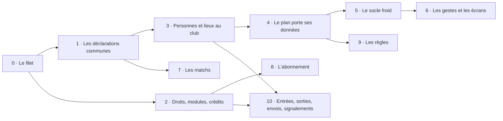

# Lot conception : découpage en lots de travail

**Statut : découpage validé par le fondateur le 2026-11-20 (ordre, premier lot de côté, cadrage).
Le lot 0 est livré en trois PR ; le lot 2 est livré sur `lot/conception`, non déployé ; les lots 1, 2, 3, 4, 5, 7 et 8 ont
chacun leur plan écrit, validé en version finale (voir §6). Déploiement unique (fondateur, 2026-11-21) : tout le lot
conception part en une seule mise en production, à la fin, depuis `lot/conception`.** Ce document dit **quoi dans quel ordre** ; le **comment**
de chaque lot est le travail de son plan (`morpheus`, puis `smith`).

Source : [`conception-cible.md`](conception-cible.md) (les numéros « § » ci-dessous y renvoient).
Constats : [`../audit/CONCEPTION-2026-11-19-claude-fable-5-2.md`](../audit/CONCEPTION-2026-11-19-claude-fable-5-2.md),
[`../audit/EPARPILLEMENT-2026-11-20-claude-fable-5-2.md`](../audit/EPARPILLEMENT-2026-11-20-claude-fable-5-2.md).
Ligne de roadmap : P1-6.

## 1. Les règles du découpage

1. **Chaque lot laisse l'application en état de marche et livrable.** Quatre clubs réels sont en
   production : aucun lot ne s'appuie sur un lot suivant pour fonctionner.
2. **Chaque lot convertit ses propres données**, par sa migration, et la prouve. Pas de conversion
   générale à la fin.
3. **Le filet d'abord.** Avant de toucher un domaine : ses scénarios de comportement existent et
   sont verts ; pendant le lot ils ne bougent pas, sauf là où le fondateur a changé la règle.
4. **Le moteur ne change dans aucun lot.** La demande qu'il reçoit est identique avant et après,
   club par club (§24, §27). C'est la preuve commune à tous les lots qui déplacent des données.
   Une seule exception assumée, au lot 0 : les lectures des constructeurs de demande sont triées
   par id, pour que la demande ne dépende plus de l'ordre physique de PostgreSQL. Deux exceptions de plus sont décidées
   pour le lot 7 (2026-11-23) : les amicaux et les domiciles de coupe ne sont plus confiés au placement automatique
   (§3, lot 7).
5. **Le lot conception = une branche `lot/conception`**, des PR vers elle (une seule branche pour tous les lots,
   décision du fondateur du 2026-11-21), une PR finale vers `main` sur le go du fondateur, **une seule mise en
   production pour l'ensemble**, à la main, site fermé (procédure dans `docs/ops/deploy.md`, écrite par la dernière
   PR avant la PR finale). Un chantier = une PR, deux au plus.
6. **Les tests accrochés à l'ancienne structure ne sont pas portés un pour un** : on garde ce qui
   protège une promesse, on supprime le reste.

Quatre gestes font partie de **chaque** lot, sans lot à eux :

| Geste | Ce que le lot fait |
|---|---|
| Ranger par domaine | Le domaine refondu passe dans son dossier (plateforme, club, structure, plans, matchs, pack sport, sorties et envois) |
| Vraies clés étrangères | Sur chaque table que le lot crée ou transforme |
| Checklist « conception » | Le plus simple, ce que le lot supprime, un seul endroit par information (`morpheus`, `smith`) |
| Documents | ADR, règles de `CLAUDE.md` touchées (§28), état des lieux |

## 2. Vue d'ensemble

| Lot | Ce que le gestionnaire voit changer | Poids | Sensible |
|---|---|---|---|
| 0 · Le filet | Rien | Moyen | Génération |
| 1 · Les déclarations communes | Rien | Moyen | Génération |
| 2 · Droits, modules, crédits | Le comblement et le PDF comptent un crédit au bon moment ; le 1er mai bloque côté serveur | Moyen | Accès, démonstration |
| 3 · Personnes et lieux au club | Un coach et un gymnase ne se ressaisissent plus d'une saison à l'autre | Lourd | Isolation, RGPD |
| 4 · Le plan porte ses données | Rien, ou presque | Lourd | Génération, cycle des plans |
| 5 · Le socle froid | Travailler le socle ne change rien avant de valider ; « Charger » ramène tout | Lourd | Cycle des plans |
| 6 · Les gestes et les écrans | Un écran « structure du club », un seul Wizard, la case « participe », la suppression forte | Lourd | Périmètre engagé |
| 7 · Les matchs | Une équipe peut jouer plusieurs compétitions ; l'amical est une compétition sans règle | Lourd | Périmètre engagé |
| 8 · L'abonnement | L'offre payante a des paliers ; au-dessus du palier, plus de sorties | Léger | Non |
| 9 · Les règles | Rien | Moyen | Sens des contraintes |
| 10 · Entrées, sorties, envois, signalements | Tous les exports et imports se comportent pareil | Moyen | Non |

Le poids est relatif, tiré du nombre de tables et de fichiers touchés ; ce n'est pas une durée.

**Ligne principale** : 0, 1, 3, 4, 5, 6. Chaque lot attend le précédent.
**Lots de côté** : 2, 7, 8, 9, 10. Ils ne touchent pas les mêmes domaines que la ligne principale et
peuvent avancer dans un espace de travail à part pendant qu'un lot principal attend une validation.

## 3. Les lots

### Lot 0 · Le filet

- **Contenu**
  - L'outil de preuve : pour chaque club, enregistrer la demande envoyée au moteur (socle, plans
    de période, placement des matchs) et la comparer au caractère près avant et après un lot ; sur
    les jeux de test et sur une copie de la production (§27).
    - **PR 1 livrée — « Un seul compositeur, un ordre stable »** : la composition de la demande au
      moteur est un seul service (`EngineRequestComposer`) et les lectures des constructeurs sont
      triées par id ; des demandes de référence (`backend/tests/Fixtures/engine-requests/`) en
      gardent le contenu.
    - **PR 2 livrée — « Les scénarios des lots 1 et 2 »** : sept features Behat, un décor dédié
      chacune, décrivent le comportement ACTUEL des domaines que les lots 1 et 2 refondent :
      saison suivante, suppression en cascade, règle de catégorie (étiquettes), membre sans rôle de
      gestion en lecture, crédits de l'offre Découverte, club de démonstration sans envoi, module
      matchs gardé par le socle ; le refus d'écrire du membre est une ligne de tableau par geste
      dans `un-club-ne-voit-jamais-un-autre-club.feature`. Ce que chacune prouve :
      `docs/testing/test-coverage-map.md` § Structure du club, § Offre Découverte, § Sécurité.
    - **PR 3 livrée — « La demande s'enregistre »** : la commande
      `app:engine-requests:record` enregistre par club les demandes que le moteur recevrait, sous
      forme d'empreintes comparables par `diff -r`. Ce qu'elle couvre, ses trous, la procédure de
      copie de la production et la règle de purge du cache au déploiement :
      [`lot-conception-filet.md`](lot-conception-filet.md).
  - L'inventaire des scénarios de comportement par domaine à refondre, et la liste des trous à
    combler avant chaque lot.
  - La mesure du temps de rendu du PDF du planning sur un grand club (réserve du §21).
- **Supprime** : rien.
- **Dépend de** : rien.
- **Preuve** : l'outil détecte une différence introduite exprès.

### Lot 1 · Les déclarations communes

- **Plan d'exécution** : [`lot-conception-1-declarations-communes.md`](lot-conception-1-declarations-communes.md)
  (version allégée, adoptée le 2026-11-21). Le lot 1 n'a pas de mise en production à lui (déploiement unique).
- **Contenu**
  - La déclaration unique des familles d'objets : à quel niveau elle vit, froide ou libre, recopiée
    à la saison suivante, présente dans une version, effacée avec quoi (§1 principe 5, §26). **Dans ce
    lot, seules les listes d'effacement (saison, club) la lisent** ; chaque lot suivant ajoute ce qu'il
    lit ; un test signale toute famille non déclarée.
  - Le créneau de semaine : un seul objet, le jour de 1 à 7, un seul endroit pour le chevauchement
    et les conversions (§11).
  - Les étiquettes calculées à la lecture (§12) ; leurs deux tables disparaissent à la première PR du lot 3,
    dans la même mise en production.
- **Constats des scénarios du lot 0 à trancher ici** (vérifiés dans le code ; les scénarios
  décrivent l'actuel) :
  - Supprimer un gymnase emporte, annoncée, la règle qui le nomme dans sa configuration
    (`forbiddenVenueId`…) : `VenueConfigConstraintStep` (PR 5), une seule liste de clés
    (`ConstraintConfigValidator::uuidKeys()`).
  - « Préparer la saison suivante » une seconde fois est refusé 409, « La saison suivante existe déjà. »
    (`SeasonAlreadyTransitionedException`), l'identifiant de la saison déjà préparée dans la réponse.
  - Le drapeau de démonstration n'est pas lu au même endroit selon le geste : l'invitation
    (`ClubInvitationController.php:79`, `:108`) et la suppression de compte
    (`DeleteAccountController.php:49`) lisent celui de l'UTILISATEUR ; l'envoi des conflits
    (`ConflictCoachMailController.php:202`) et des liens de collecte
    (`CoachWishCampaignActionController.php:92`) lisent celui du CLUB. **Constat fermé par la
    PR 5 du lot 2** (régime de démonstration déclaré une fois), accepté par le fondateur.
  - **Constats de la PR 2 du lot 2, tranchés par la PR 5 du lot 1** : `POST /api/seasons` est retiré (405, la
    ressource `Season` est en lecture seule) ; la garde de date de `transition` garde son ordre (rôle, saison en
    cours, date, paiement, successeur), le cas d'un successeur déjà préparé avant le 1er mai ne reste possible que
    pour un club de démonstration dont l'horloge est ramenée en arrière.
- **Conditions d'entrée** (héritées du lot 0, [`lot-conception-filet.md`](lot-conception-filet.md)) :
  - **Purge de `cache.schedule` au déploiement automatisée** (PR 1 du lot) : `scripts/remote-deploy.sh`
    la lance après « Deploy … OK » ; un échec laisse le déploiement réussi, avec une alerte au journal
    et la commande à relancer à la main (`docs/ops/deploy.md`).
  - **La procédure de copie de la production** (§7 du filet) est la preuve de ce lot : accord du
    fondateur à chaque restauration, restauration qui garde les droits d'`amateo_app` et la RLS,
    dump effacé à la fin. Les trous de l'enregistrement (§6 du filet) sont à relire avant de
    conclure « demande identique ».
- **Supprime** : les trois listes d'effacement de saison et de club (remplacées par la déclaration),
  les calculs d'horaires réécrits. Les autres listes (copie, photo, restauration…) meurent avec le lot
  qui les réécrit ; les tables d'étiquettes (96 et 411 lignes en production) partent à la première PR
  du lot 3.
- **Ne fait pas** : changer « Charger » (retourne au lot 5, limite écrite dans le plan).
- **Dépend de** : lot 0.
- **Preuve** : demande au moteur identique.

### Lot 2 · Droits, modules, crédits

- **Plan d'exécution** : [`lot-conception-2-droits-modules-credits.md`](lot-conception-2-droits-modules-credits.md)
  (version finale ; livré sur `lot/conception`, non déployé).
- **Contenu**
  - Le module déclaré une fois par fonction (module, lecture ou écriture, sortie payante, envoi à
    un tiers) ; un seul contrôle ; la condition « socle validé » portée par le module (§8).
  - La règle unique du crédit : pris quand la sortie est obtenue ; le comblement en consomme un.
    - **PR 4 livrée — « Les crédits »** : la sortie payante se déclare (`ClubFunction::$output`,
      `backend/src/Access/Output.php`) ; le refus « crédits épuisés » rejoint le contrôle central ;
      génération et placement prennent le crédit dans la transaction de leur résultat, le PDF du
      planning par un crédit strict à la livraison ; une génération qui n'aboutit pas ne coûte rien ;
      le comblement est payant (décision et écarts E9, E10 : `etat-des-lieux.md` §2).
  - Deux rôles seulement, colonne fermée (§9).
    - **PR 1 livrée — « Deux rôles, colonne fermée »** : `club_user.role` et `club_invitation.role`
      n'acceptent que `admin` et `member` (CHECK, migration `Version20261120120000`) ;
      `ClubRole::isManager()` remplace la liste `MANAGEMENT_ROLES` et `isManagementRole`.
    - **PR 3a livrée — « Chaque fonction se déclare »** : chaque route de club porte son module et
      son public (`#[ClubFunction]`, `#[ClubResource]`, `#[AccountFunction]`, `backend/src/Access/`),
      balayée par `AccessDeclarationSweepTest`
      (convention : `backend/docs/backend-controllers.md` § Déclarer l'accès d'une route).
    - **PR 3b livrée — « Le contrôle s'active, les gardes à la main partent »** :
      `ClubAccessListener` (`kernel.request`, priorité 4) refuse 403 un Membre sur une fonction
      « gestionnaire » ; `assertManager()` et le défaut de `AbstractStateProcessor` sont supprimés
      (décision et écarts E1 à E5 : `etat-des-lieux.md` §2).
  - Le régime de démonstration déclaré une fois (§10). **Livré (PR 5).**
  - La règle du 1er mai côté serveur.
    - **PR 2 livrée — « Le 1er mai côté serveur »** : la bascule vers la saison suivante est refusée
      409 avant le 1er mai (`SeasonTransitionService::preparationOpensOn`), `/api/me` sert la date
      (`seasonPreparationOpensOn`) ; la borne haute reste à l'écran.
- **Supprime** : les deux listes de noms de routes des crédits (celle du débit selon la décision de
  cadrage du lot), les appels à la main du contrôle gestionnaire et 8 des 21 appels à la main du socle
  validé, 8 des exceptions de démonstration écrites une par une (6 autres regroupées en une règle).
- **Dépend de** : rien.
- **Preuve** : scénarios d'accès par rôle et par offre ; revue de sécurité obligatoire (accès,
  démonstration).

### Lot 3 · Personnes et lieux au club

- **Contenu**
  - La personne au club, avec ses rôles (coach, salarié) et ses contacts ; le lieu au club ; le
    gymnase de la saison comme usage d'un lieu (§3, §9, §13).
  - Les temps de trajet au club, une fois (§13).
  - Effacer une personne l'anonymise (§9).
  - « Préparer la saison suivante » ne recopie plus les personnes ni les lieux.
  - Conversion : 52 coachs, 18 gymnases, sans fusion (§27).
- **Plan d'exécution** : [`lot-conception-3-personnes-et-lieux.md`](lot-conception-3-personnes-et-lieux.md)
  (version finale, validée par le fondateur le 2026-11-21 ; six PR).
- **Condition d'entrée** (lot 1, [plan](lot-conception-1-declarations-communes.md) §4) : **la première PR du
  lot supprime les deux tables d'étiquettes** (`team_tag`, `team_tag_assignment`, migration irréversible),
  **dans la même mise en production que le lot 1** (déploiement unique : plus de « une release d'écart », plus de
  branche `lot/personnes-lieux`) ; elle s'ouvre quand le lot 1 est mergé sur `lot/conception`. Y entre aussi la
  fermeture du cache des demandes par une époque dans la clé.
- **Supprime** : la recopie des coachs et des gymnases chaque saison, le barème de trajet par
  saison, les deux tables d'étiquettes.
- **Dépend de** : lot 1 (mergé sur `lot/conception`, pas déployé : une seule mise en production à la fin).
- **Preuve** : demande au moteur identique (les identifiants envoyés ne changent pas) ; revue de
  sécurité obligatoire (isolation entre clubs, données personnelles).

### Lot 4 · Le plan porte ses données

- **Plan d'exécution** : [`lot-conception-4-le-plan-porte-ses-donnees.md`](lot-conception-4-le-plan-porte-ses-donnees.md)
  (version finale, validée par le fondateur le 2026-11-22 ; six PR). S'exécute après le lot 3 entier.
- **Écart à cette fiche (E1, validé par le fondateur en validant le plan)** : une contrainte reste rangée à la saison (son
  identifiant part au moteur) ; le plan porte la liste de celles qu'il applique. « Les contraintes appartiennent au plan »
  n'est donc pas fait par ce lot (lots 5 et 9). Les autres écarts à la cible (E2 à E6) sont au §3.7 du plan.
- **Décision du fondateur (2026-11-22)** : un plan de vacances déjà commencé garde ce qu'il avait à sa création (séances,
  plafond par jour, règles de bien-être), tant que le gestionnaire ne le change pas dans ce plan ; à l'écran, les équipes
  dont le socle a changé depuis y apparaissent avec un réglage propre : seul changement visible du lot, hors information
  (la pré-sélection des équipes d'un plan de vacances se fait à sa création).
- **Livré sur `lot/conception`, non déployé** : PR 1 (le filet), PR 2 (le socle a son plan de saison), PR 3a (les équipes d'un plan), PR 3b (les gymnases d'une période), PR 4 (les règles appliquées, la nature sur le plan) et PR 5 (un constructeur de la demande au moteur, une copie de naissance lue sur le catalogue). Les lots 5, 6 et 9 en dépendent (« Dépend de : lot 4 ») et peuvent s'ouvrir.
- **Contenu**
  - Le socle devient un plan comme les autres : grille, occupations, réservations, mutualisations,
    réglages des règles, contraintes, passerelles, règle de trajet, composition (participation,
    séances, plafond par jour) appartiennent au plan (§3, §12, §13).
  - La nature écrite sur le plan, lue par tout ce qui décide de son comportement (§11).
  - Un seul constructeur de la demande au moteur ; une seule copie de naissance ; un seul pointeur
    de version chargée.
  - Conversion : 10 plans, 274 + 129 + 26 lignes d'exception à verser dans les plans (§27).
- **Supprime** : la bifurcation « plan nul = socle » (une douzaine de fichiers), les trois tables
  d'exception de période, le second constructeur, quatre des cinq routines de copie, le drapeau de
  tri d'équipes.
- **Dépend de** : lot 3 (mergé sur `lot/conception`, pas déployé).
- **Preuve** : demande au moteur identique pour le socle et pour chaque plan de période. Deux
  chantiers : déplacer les données à comportement égal, puis retirer les mécanismes d'exception.

### Lot 5 · Le socle froid

- **Plan d'exécution** : [`lot-conception-5-le-socle-froid.md`](lot-conception-5-le-socle-froid.md) (version finale, plan écrit et
  validé par le fondateur le 2026-11-24 avec ses décisions 1 à 8, §10 du plan ; sept PR). Ordre d'exécution : PR 1 à 3, puis le
  lot 7, puis PR 4 à 7. **Statut : PR 1 et 2 livrées** (le filet : références 20 et 21, scénario de « Charger » ; le froid se déclare et chaque version en copie le froid, table `schedule_state` ; écarts dans §4 du plan).
- **Écarts à cette fiche (validés avec le plan)**
  - E1 : contraintes permanentes, passerelles, règle de trajet et coach principal restent rangés à la saison, déclarés « froid du socle » (lot 9 pour les déplacer).
  - E2 : les clés étrangères vers équipe et gymnase passent au lot 6 ; aucune clé vers `constraint` tant que E1 dure.
  - E3 : deux mesures (« périmé ? » et « qu'est-ce qui change ? »), tenues par une garde « une clé de la demande, une source ».
  - E4 : les plans de période gardent « Rouvrir » dans ce lot ; la règle du socle leur vient avec le Wizard du lot 6.
  - E5 : « Charger » remet aussi le froid porté par les équipes et les gymnases existants (rang, catégorie, niveau, « divisible », gymnase imposé), ce qui revient sur la cible §15.
  - E6 : le geste « Valider ces modifications » est le seul qui écrit la version en vigueur (coach de ses séances, entrée figée, empreinte) : exception nommée à « seule la version chargée se modifie ».
- **Contenu**
  - L'état de travail et la version en vigueur ; une version = la copie complète du froid ;
    l'empreinte ne porte que sur le froid (§4, §5, §14).
  - Valider : la liste de ce qui change ; destruction des plans de période non commencés seulement
    si du froid a changé ; les doléances et la campagne conservées (§14, §16).
  - « Charger » : une seule définition, tout l'état du plan (§15).
  - « Préparer la saison suivante » : tout est repris, par la déclaration du lot 1 (§15).
  - Les matchs et le radar lisent ce qui est en vigueur par une seule porte (§17).
  - L'état visible « des modifications attendent la validation » (§19).
- **Condition d'entrée** (décision du 2026-11-21, [plan du lot 1](lot-conception-1-declarations-communes.md) §3.3) :
  le lot 1 ne change pas « Charger ». Jusqu'au lot 5, charger une version remet les catégories du club dans
  l'état de cette version : une durée de match modifiée depuis revient à sa valeur d'alors, et une catégorie
  créée depuis par un import disparaît. Le lot 5 met fin à cela (une version ne touche que son plan, §15).
- **Supprime** : la photo de structure et sa restauration, la seconde définition de « Charger », la
  purge des doléances à la validation du socle.
- **Dépend de** : lot 4.
- **Preuve** : scénarios du cycle d'un plan réécrits là où la règle a changé ; nouvel ADR à la
  place de l'ADR-0002 (§28).

### Lot 6 · Les gestes et les écrans

- **Contenu**
  - L'écran « structure du club » ; le Wizard d'un plan, le même pour le socle et les périodes
    (§19).
  - La case « participe » pour les équipes et les gymnases du socle (§14, §13).
  - La suppression forte d'une équipe, d'un gymnase, d'un coach : alerte, puis « supprimer » en
    toutes lettres ; les matchs d'un gymnase supprimé redeviennent « à placer » (§14).
  - La liste des coachs avec leurs contacts.
  - Une déclaration par objet pour les données de l'écran (§20) ; la page du planning rangée.
- **Supprime** : les écrans de période en double, les trois exemplaires des types équipe, coach et
  gymnase, le pont manuel entre les clés en mémoire.
- **Dépend de** : lot 5.
- **Preuve** : scénarios de bout en bout ; contrôle visuel des écrans nouveaux.

### Lot 7 · Les matchs

- **Plan d'exécution** : [`lot-conception-7-les-matchs.md`](lot-conception-7-les-matchs.md) (version finale, validée par
  le fondateur le 2026-11-23 avec ses décisions Q1 à Q10, §13 du plan ; neuf PR). S'exécute après le lot 4 et après les PR 1 à 3 du lot 5 (« Charger » en une définition, sans photo de structure : la Q10 du plan du lot 7 devient sans objet, ses PR 3b et 4a ne touchent plus `StructureRestorer` ni `RestoreFeasibility`, son E3 pointe le lot 6). PR 1 livrée (le filet).
- **Écarts à cette fiche (validés avec le plan)** : une compétition ne porte aucune règle propre (jours, heures, durée) :
  la seule règle par nature est la borne des coupes, 08:00 à 21:00, en constante (E1 du plan, reprise en ligne de
  roadmap après le lot conception) ; une division neuve jouée par deux équipes donne une compétition par équipe, et la
  séparation compétition / engagement ne se voit que sur « Amicaux » (Q8) ; les fenêtres de ligue ne sont plus appliquées
  aux coupes ; le repli de ligue est dit par un bandeau (PR 5). **Deux exceptions à la règle 4 du §1** : les matchs d'une
  compétition amicale (Q6) et les domiciles de coupe (Q7) ne sont plus confiés au système de placement ; la demande au
  moteur est identique pour tout le reste.
- **Contenu**
  - Compétition et engagement séparés ; la nature écrite une fois, amical compris ; la compétition
    « Amicaux » d'office (§18).
  - Les règles portées par la compétition ; les fenêtres de ligue comme règles par défaut ; le
    repli de ligue dit au club (§18).
  - Le suivi fédéral séparé du match (§18).
  - Une seule liste des types de conflit (§23).
  - L'import des matchs : une division vers une compétition et un engagement (§22).
  - Conversion : 150 compétitions, 677 matchs, 5 compétitions à passer en nature amicale (§27).
- **Supprime** : la nature relue dans les libellés (six endroits), le cas « match sans
  compétition », les listes de types de conflit recopiées.
- **Dépend de** : lot 1. Indépendant des lots 3 à 6 pour le code ; **s'exécute après le lot 4** (décision du fondateur,
  2026-11-23) **et après les PR 1 à 3 du lot 5** (décision du fondateur, 2026-11-24).
- **Preuve** : demande de placement au moteur identique, hors les deux exceptions ci-dessus ; scénarios d'import et de
  placement.

### Lot 8 · L'abonnement

- **Plan d'exécution** : [`lot-conception-8-abonnement.md`](lot-conception-8-abonnement.md) (version finale,
  validée par le fondateur le 2026-11-22 avec ses six décisions, §12 du plan ; trois PR).
- **Contenu**
  - La ligne d'abonnement par club et par saison ; une offre payante (« Offre complète ») à trois paliers (jusqu'à
    20 équipes, de 21 à 34, 35 et plus) ; la place du prix, sans écran ; au-dessus du palier, plus de sorties (§7).
  - Les actions de support écrivent cette ligne (§24) ; chaque saison a son offre ; le bouton « Marquer la saison
    suivante payée » est retiré, le geste « Offre » fait offre, palier et saison.
  - Toutes les équipes comptent pour le palier, désactivées comprises ; au-dessus du palier : un bandeau permanent et le
    refus au clic, les boutons ne sont pas grisés.
  - Conversion : 3 lignes (les clubs en Bêta ; un club en Découverte n'a pas de ligne), à confirmer par la mesure du
    plan (§8).
- **Supprime** : l'offre et la dernière saison réglée sur le club, deux des trois offres payantes.
- **Dépend de** : lot 2. S'exécute après la PR 1 du lot 3 (une seule PR ouverte à la fois : les deux lots modifient
  `SeasonTransitionService.php`, `ErasedClubPurger.php`, l'état des lieux et ce fichier).
- **Preuve** : scénarios d'offre effective et de dépassement.

### Lot 9 · Les règles

- **Contenu** (§26, tableau du relevé)
  - Une seule forme pour une règle d'entraînement et une règle de match, deux familles conservées.
  - Un seul vocabulaire d'intensité.
  - L'indisponibilité d'un coach à un seul endroit, lue par l'entraînement, les matchs et le
    transfert des doléances.
  - Le réglage de trajet rangé avec les autres réglages de règles.
  - Le jour de match et le gymnase imposé à un seul endroit chacun.
- **Supprime** : la table de réglage de trajet, quatre vocabulaires d'intensité sur cinq, les
  colonnes de règle en double sur l'équipe.
- **Dépend de** : lot 4.
- **Preuve** : demande au moteur identique ; test de sens des contraintes.

### Lot 10 · Entrées, sorties, envois, signalements

- **Contenu**
  - Un seul chemin pour tout export, sous réserve de la mesure du lot 0 (§21).
  - Un seul déroulé et un seul contrôle d'entrée pour tout import (§22).
  - Un seul journal des envois ; les trois journaux de rappel y entrent (§26).
  - La forme commune de ce qu'Amateo signale (§23).
- **Supprime** : la file d'attente du PDF du planning et son état sur la version, deux contrôles
  d'entrée d'import sur trois, les trois tables de rappel et les dates d'envoi éparpillées.
- **Dépend de** : lots 2 et 3.
- **Preuve** : un scénario par export et par import.

## 4. Ce qui n'est pas dans ces lots

| Sujet | Où |
|---|---|
| Planning des salariés, semaines A et B, planning d'essai | Après les onze lots (fondateur, 2026-11-20) |
| Ce que le backend fait et que rien n'utilise | Ligne de roadmap P4-615 |
| Avertir quand une règle de match recouvre un entraînement | Ligne de roadmap P4-616 |
| Prévenir avant génération en construisant sans résoudre | Ligne de roadmap P4-617, après tous ces lots |
| Écran de paiement, facture, second sport, compétition saisie à la main | Non construits : la place est faite |
| Commentaires qui citent « §7.2 » de `CLAUDE.md` | Quatorze commentaires citent encore « §7.2 » de `CLAUDE.md`, section disparue, sans nommer le fichier : douze dans `frontend/src`, deux dans `backend/src/Service`. Les retirer est du code, donc `neo` ; petite PR à part si le fondateur la veut |

## 5. Décisions du fondateur (2026-11-20)

1. **L'ordre est validé** : ligne principale 0, 1, 3, 4, 5, 6 ; lots de côté 2, 7, 8, 9, 10.
2. **Le lot 2 (droits, modules, crédits) est le premier lot de côté**, mené en parallèle de la
   ligne principale.
3. **La conception validée tient lieu de cadrage** : chaque lot va directement à son plan
   (`morpheus`, puis `smith`), sans repasser par `oracle`.
4. **Les trois besoins (salariés, semaines A et B, essai) se font après les onze lots**, pas au fil
   de l'eau.

## 6. Où en est chaque lot

Ce document porte la fiche de chaque lot (contenu, ce qu'il supprime, dépendances, preuve).
**Le lot 0 est livré en trois PR** (compositeur, scénarios, enregistreur) la mesure du PDF restant
une procédure à jouer ([`lot-conception-filet.md`](lot-conception-filet.md) §8) ; **le lot 2 est livré sur `lot/conception`, non déployé** (deux rôles ; le 1er mai côté serveur ; les déclarations d'accès ; le contrôle central ; les crédits à l'obtention ; le module matchs qui porte le socle et le régime de démonstration déclaré une fois) ; **le lot 1 est livré sur `lot/conception`, non déployé** (PR 1 à 5 : purge du cache au déploiement ; créneau de semaine ; étiquettes calculées à la lecture ; familles déclarées et purges qui les lisent ; constats tranchés) ; **le lot 3
est livré sur `lot/conception`, non déployé** (PR 1, 2a, 2b, 3, 4 et 5 : « L'entrée du lot » : tables d'étiquettes supprimées, époque du schéma dans la clé du cache ; une seule porte de lecture de l'identité ; la personne au club ; effacer une personne par `app:people:erase` ; le lieu au club ; les temps de trajet au club) ; **le lot 4 est livré sur `lot/conception`, non déployé** (plan validé le 2026-11-22 ; six PR : le filet, quinze références de demande au moteur et la chaîne de conversion sur base dédiée ; le socle a son plan de saison ; les équipes d'un plan, une ligne par plan et par équipe ; les gymnases d'une période ; les règles appliquées et la nature sur le plan ; un constructeur de la demande au moteur et une copie de naissance) ; **le lot 8 a livré ses trois PR** (une ligne d'abonnement par club et par saison ; une offre payante, trois paliers ; au-dessus du palier, plus de sorties) : il s'est exécuté après la PR 1 du lot 3, pour ne pas ouvrir deux PR sur `SeasonTransitionService.php`, `ErasedClubPurger.php`, l'état des lieux et ce fichier. **Le lot 7 est en cours** (plan validé le 2026-11-23 ; PR 1 et 2 livrées sur `lot/conception`, non déployées : le filet des matchs, références 16 à 19 et vues des matchs enregistrées ; une seule liste des types de conflit) : il s'exécute après le lot 4, livré, et après les PR 1 à 3 du lot 5. **Le lot 5 est en cours** (plan écrit et validé le 2026-11-24 ; sept PR : PR 1 à 3, puis le lot 7, puis PR 4 à 7 ; PR 1 et 2 livrées sur `lot/conception`, non déployées : le filet ; le froid se déclare, une version copie tout le froid). Les plans des lots 1, 2, 3, 4, 5, 7 et 8 sont dans
[`lot-conception-1-declarations-communes.md`](lot-conception-1-declarations-communes.md),
[`lot-conception-2-droits-modules-credits.md`](lot-conception-2-droits-modules-credits.md),
[`lot-conception-3-personnes-et-lieux.md`](lot-conception-3-personnes-et-lieux.md),
[`lot-conception-4-le-plan-porte-ses-donnees.md`](lot-conception-4-le-plan-porte-ses-donnees.md),
[`lot-conception-5-le-socle-froid.md`](lot-conception-5-le-socle-froid.md),
[`lot-conception-7-les-matchs.md`](lot-conception-7-les-matchs.md) et
[`lot-conception-8-abonnement.md`](lot-conception-8-abonnement.md) ; les autres lots n'ont pas de
plan écrit. Un plan s'écrit lot par lot, dans un fichier à lui (`specs/evolution/`), et se valide en entier avant tout
code. Une seule PR est ouverte à la fois sur `lot/conception` (les lots 1 et 2 modifient ce fichier et l'état des lieux).

**Jalons de la mise en production unique** (décision du fondateur, 2026-11-21) : (1) copie de production n° 1, avant le
merge de la PR 3 du lot 1 ; (2) la dernière PR avant la PR finale écrit dans `docs/ops/deploy.md` la procédure de mise
en production manuelle, site fermé (ordre des migrations de tous les lots, vérifications, retour arrière = restauration
de la sauvegarde d'avant, correction en avant après réouverture), relue par le fondateur ; (3) copie de production n° 2 =
rejeu de TOUTES les migrations ensemble ; (4) PR finale `lot/conception` → `main`, GO du fondateur ; (5) mise en
production. Chaque copie de production se fait après accord du fondateur. La migration du lot 8 y est rejouée avec les autres ; son décompte doit donner les mêmes nombres que la mesure de `link` (plan du lot 8, §8).
