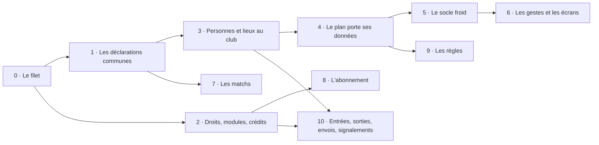

# Lot conception : découpage en lots de travail

**Statut : découpage validé par le fondateur le 2026-11-20 (ordre, premier lot de côté, cadrage).
Le lot 0 est livré en trois PR ; le lot 2 a livré sa PR 1 (voir §6).** Ce document dit **quoi dans
quel ordre** ; le **comment** de chaque lot est le travail de son plan (`morpheus`, puis `smith`).

Source : [`conception-cible.md`](conception-cible.md) (les numéros « § » ci-dessous y renvoient).
Constats : [`../audit/CONCEPTION-2026-11-19-claude-fable-5-2.md`](../audit/CONCEPTION-2026-11-19-claude-fable-5-2.md),
[`../audit/EPARPILLEMENT-2026-11-20-claude-fable-5-2.md`](../audit/EPARPILLEMENT-2026-11-20-claude-fable-5-2.md).
Ligne de roadmap : P1-6.

## 1. Les règles du découpage

1. **Chaque lot laisse l'application en état de marche et livrable.** Quatre clubs réels sont en
   production : aucun lot ne s'appuie sur un lot suivant pour fonctionner.
2. **Chaque lot convertit ses propres données**, par sa migration, et la prouve. Pas de conversion
   générale à la fin.
3. **Le filet d'abord.** Avant de toucher un domaine : ses scénarios de comportement existent et
   sont verts ; pendant le lot ils ne bougent pas, sauf là où le fondateur a changé la règle.
4. **Le moteur ne change dans aucun lot.** La demande qu'il reçoit est identique avant et après,
   club par club (§24, §27). C'est la preuve commune à tous les lots qui déplacent des données.
   Une seule exception assumée, au lot 0 : les lectures des constructeurs de demande sont triées
   par id, pour que la demande ne dépende plus de l'ordre physique de PostgreSQL.
5. **Un lot = une branche `lot/<sujet>`**, des PR vers elle, une PR finale vers `main` sur le go du
   fondateur. Un chantier = une PR, deux au plus.
6. **Les tests accrochés à l'ancienne structure ne sont pas portés un pour un** : on garde ce qui
   protège une promesse, on supprime le reste.

Quatre gestes font partie de **chaque** lot, sans lot à eux :

| Geste | Ce que le lot fait |
|---|---|
| Ranger par domaine | Le domaine refondu passe dans son dossier (plateforme, club, structure, plans, matchs, pack sport, sorties et envois) |
| Vraies clés étrangères | Sur chaque table que le lot crée ou transforme |
| Checklist « conception » | Le plus simple, ce que le lot supprime, un seul endroit par information (`morpheus`, `smith`) |
| Documents | ADR, règles de `CLAUDE.md` touchées (§28), état des lieux |

## 2. Vue d'ensemble

| Lot | Ce que le gestionnaire voit changer | Poids | Sensible |
|---|---|---|---|
| 0 · Le filet | Rien | Moyen | Génération |
| 1 · Les déclarations communes | Rien | Moyen | Génération |
| 2 · Droits, modules, crédits | Le comblement et le PDF comptent un crédit au bon moment ; le 1er mai bloque côté serveur | Moyen | Accès, démonstration |
| 3 · Personnes et lieux au club | Un coach et un gymnase ne se ressaisissent plus d'une saison à l'autre | Lourd | Isolation, RGPD |
| 4 · Le plan porte ses données | Rien, ou presque | Lourd | Génération, cycle des plans |
| 5 · Le socle froid | Travailler le socle ne change rien avant de valider ; « Charger » ramène tout | Lourd | Cycle des plans |
| 6 · Les gestes et les écrans | Un écran « structure du club », un seul Wizard, la case « participe », la suppression forte | Lourd | Périmètre engagé |
| 7 · Les matchs | Une équipe peut jouer plusieurs compétitions ; l'amical est une compétition sans règle | Lourd | Périmètre engagé |
| 8 · L'abonnement | L'offre payante a des paliers ; au-dessus du palier, plus de sorties | Léger | Non |
| 9 · Les règles | Rien | Moyen | Sens des contraintes |
| 10 · Entrées, sorties, envois, signalements | Tous les exports et imports se comportent pareil | Moyen | Non |

Le poids est relatif, tiré du nombre de tables et de fichiers touchés ; ce n'est pas une durée.

**Ligne principale** : 0, 1, 3, 4, 5, 6. Chaque lot attend le précédent.
**Lots de côté** : 2, 7, 8, 9, 10. Ils ne touchent pas les mêmes domaines que la ligne principale et
peuvent avancer dans un espace de travail à part pendant qu'un lot principal attend une validation.

## 3. Les lots

### Lot 0 · Le filet

- **Contenu**
  - L'outil de preuve : pour chaque club, enregistrer la demande envoyée au moteur (socle, plans
    de période, placement des matchs) et la comparer au caractère près avant et après un lot ; sur
    les jeux de test et sur une copie de la production (§27).
    - **PR 1 livrée — « Un seul compositeur, un ordre stable »** : la composition de la demande au
      moteur est un seul service (`EngineRequestComposer`) et les lectures des constructeurs sont
      triées par id ; des demandes de référence (`backend/tests/Fixtures/engine-requests/`) en
      gardent le contenu.
    - **PR 2 livrée — « Les scénarios des lots 1 et 2 »** : sept features Behat, un décor dédié
      chacune, décrivent le comportement ACTUEL des domaines que les lots 1 et 2 refondent :
      saison suivante, suppression en cascade, règle de catégorie (étiquettes), membre sans rôle de
      gestion en lecture, crédits de l'offre Découverte, club de démonstration sans envoi, module
      matchs gardé par le socle ; le refus d'écrire du membre est une ligne de tableau par geste
      dans `un-club-ne-voit-jamais-un-autre-club.feature`. Ce que chacune prouve :
      `docs/testing/test-coverage-map.md` § Structure du club, § Offre Découverte, § Sécurité.
    - **PR 3 livrée — « La demande s'enregistre »** : la commande
      `app:engine-requests:record` enregistre par club les demandes que le moteur recevrait, sous
      forme d'empreintes comparables par `diff -r`. Ce qu'elle couvre, ses trous, la procédure de
      copie de la production et la règle de purge du cache au déploiement :
      [`lot-conception-filet.md`](lot-conception-filet.md).
  - L'inventaire des scénarios de comportement par domaine à refondre, et la liste des trous à
    combler avant chaque lot.
  - La mesure du temps de rendu du PDF du planning sur un grand club (réserve du §21).
- **Supprime** : rien.
- **Dépend de** : rien.
- **Preuve** : l'outil détecte une différence introduite exprès.

### Lot 1 · Les déclarations communes

- **Contenu**
  - La déclaration unique des familles d'objets : à quel niveau elle vit, froide ou libre, recopiée
    à la saison suivante, présente dans une version, effacée avec quoi (§1 principe 5, §26). Les
    listes d'effacement et de copie la lisent ; un test signale toute famille non déclarée.
  - Le créneau de semaine : un seul objet, le jour de 1 à 7, un seul endroit pour le chevauchement
    et les conversions (§11).
  - Les étiquettes calculées à la lecture ; leurs deux tables disparaissent (§12).
- **Constats des scénarios du lot 0 à trancher ici** (vérifiés dans le code ; les scénarios
  décrivent l'actuel) :
  - Supprimer un gymnase n'emporte pas une règle qui le nomme dans sa configuration
    (`forbiddenVenueId`…) : `backend/src/Deletion/ScopedConstraintStep.php:36-50` compare la portée
    et la cible (`scope`, `scopeTargetId`), jamais la configuration. Scénario volontairement NON
    écrit : la règle à tenir est une décision du lot.
  - « Préparer la saison suivante » une seconde fois est refusé 409 avec un message en anglais,
    « A next season already exists for this club. »
    (`backend/src/Service/SeasonAlreadyTransitionedException.php:19`) ; l'identifiant de la saison
    déjà préparée est dans la réponse (`SeasonTransitionController.php:69`).
  - L'import des rencontres refusé à un membre sans rôle de gestion répond
    `{"error":"Forbidden."}` (`backend/src/Service/FixtureImportGate.php:60`), pas le message des
    autres gestes du gestionnaire ; le lot 2 (PR 3b, écart E4) l'harmonise.
  - Le drapeau de démonstration n'est pas lu au même endroit selon le geste : l'invitation
    (`ClubInvitationController.php:75`, `:104`) et la suppression de compte
    (`DeleteAccountController.php:47`) lisent celui de l'UTILISATEUR ; l'envoi des conflits
    (`ConflictCoachMailController.php:202`) et des liens de collecte
    (`CoachWishCampaignActionController.php:92`) lisent celui du CLUB.
- **Conditions d'entrée** (héritées du lot 0, [`lot-conception-filet.md`](lot-conception-filet.md)) :
  - **Automatiser la purge de `cache.schedule` au déploiement** : aujourd'hui une étape manuelle
    (`docs/ops/deploy.md`), acceptable pour le lot 0 seulement. Le déploiement programmé tourne sans
    personne, et l'ancienne stack tourne encore entre la migration et le redémarrage des services.
  - **La procédure de copie de la production** (§7 du filet) est la preuve de ce lot : accord du
    fondateur à chaque restauration, restauration qui garde les droits d'`amateo_app` et la RLS,
    dump effacé à la fin. Les trous de l'enregistrement (§6 du filet) sont à relire avant de
    conclure « demande identique ».
- **Supprime** : les listes tenues à la main (sept d'effacement, cinq de copie), les calculs
  d'horaires réécrits, les tables d'étiquettes (96 et 411 lignes en production).
- **Dépend de** : lot 0.
- **Preuve** : demande au moteur identique.

### Lot 2 · Droits, modules, crédits

- **Contenu**
  - Le module déclaré une fois par fonction (module, lecture ou écriture, sortie payante, envoi à
    un tiers) ; un seul contrôle ; la condition « socle validé » portée par le module (§8).
  - La règle unique du crédit : pris quand la sortie est obtenue ; le comblement en consomme un.
  - Deux rôles seulement, colonne fermée (§9).
    - **PR 1 livrée — « Deux rôles, colonne fermée »** : `club_user.role` et `club_invitation.role`
      n'acceptent que `admin` et `member` (CHECK, migration `Version20261120120000`) ;
      `ClubRole::isManager()` remplace la liste `MANAGEMENT_ROLES` et `isManagementRole`.
  - Le régime de démonstration déclaré une fois (§10).
  - La règle du 1er mai côté serveur.
- **Supprime** : les deux listes de noms de routes des crédits (celle du débit selon la décision de
  cadrage du lot), les appels à la main du contrôle gestionnaire et 8 des 21 appels à la main du socle
  validé, 8 des exceptions de démonstration écrites une par une (6 autres regroupées en une règle).
- **Dépend de** : rien.
- **Preuve** : scénarios d'accès par rôle et par offre ; revue de sécurité obligatoire (accès,
  démonstration).

### Lot 3 · Personnes et lieux au club

- **Contenu**
  - La personne au club, avec ses rôles (coach, salarié) et ses contacts ; le lieu au club ; le
    gymnase de la saison comme usage d'un lieu (§3, §9, §13).
  - Les temps de trajet au club, une fois (§13).
  - Effacer une personne l'anonymise (§9).
  - « Préparer la saison suivante » ne recopie plus les personnes ni les lieux.
  - Conversion : 52 coachs, 18 gymnases, sans fusion (§27).
- **Supprime** : la recopie des coachs et des gymnases chaque saison, le barème de trajet par
  saison.
- **Dépend de** : lot 1.
- **Preuve** : demande au moteur identique (les identifiants envoyés ne changent pas) ; revue de
  sécurité obligatoire (isolation entre clubs, données personnelles).

### Lot 4 · Le plan porte ses données

- **Contenu**
  - Le socle devient un plan comme les autres : grille, occupations, réservations, mutualisations,
    réglages des règles, contraintes, passerelles, règle de trajet, composition (participation,
    séances, plafond par jour) appartiennent au plan (§3, §12, §13).
  - La nature écrite sur le plan, lue par tout ce qui décide de son comportement (§11).
  - Un seul constructeur de la demande au moteur ; une seule copie de naissance ; un seul pointeur
    de version chargée.
  - Conversion : 10 plans, 274 + 129 + 26 lignes d'exception à verser dans les plans (§27).
- **Supprime** : la bifurcation « plan nul = socle » (une douzaine de fichiers), les trois tables
  d'exception de période, le second constructeur, quatre des cinq routines de copie, le drapeau de
  tri d'équipes.
- **Dépend de** : lot 3.
- **Preuve** : demande au moteur identique pour le socle et pour chaque plan de période. Deux
  chantiers : déplacer les données à comportement égal, puis retirer les mécanismes d'exception.

### Lot 5 · Le socle froid

- **Contenu**
  - L'état de travail et la version en vigueur ; une version = la copie complète du froid ;
    l'empreinte ne porte que sur le froid (§4, §5, §14).
  - Valider : la liste de ce qui change ; destruction des plans de période non commencés seulement
    si du froid a changé ; les doléances et la campagne conservées (§14, §16).
  - « Charger » : une seule définition, tout l'état du plan (§15).
  - « Préparer la saison suivante » : tout est repris, par la déclaration du lot 1 (§15).
  - Les matchs et le radar lisent ce qui est en vigueur par une seule porte (§17).
  - L'état visible « des modifications attendent la validation » (§19).
- **Supprime** : la photo de structure et sa restauration, la seconde définition de « Charger », la
  purge des doléances à la validation du socle.
- **Dépend de** : lot 4.
- **Preuve** : scénarios du cycle d'un plan réécrits là où la règle a changé ; nouvel ADR à la
  place de l'ADR-0002 (§28).

### Lot 6 · Les gestes et les écrans

- **Contenu**
  - L'écran « structure du club » ; le Wizard d'un plan, le même pour le socle et les périodes
    (§19).
  - La case « participe » pour les équipes et les gymnases du socle (§14, §13).
  - La suppression forte d'une équipe, d'un gymnase, d'un coach : alerte, puis « supprimer » en
    toutes lettres ; les matchs d'un gymnase supprimé redeviennent « à placer » (§14).
  - La liste des coachs avec leurs contacts.
  - Une déclaration par objet pour les données de l'écran (§20) ; la page du planning rangée.
- **Supprime** : les écrans de période en double, les trois exemplaires des types équipe, coach et
  gymnase, le pont manuel entre les clés en mémoire.
- **Dépend de** : lot 5.
- **Preuve** : scénarios de bout en bout ; contrôle visuel des écrans nouveaux.

### Lot 7 · Les matchs

- **Contenu**
  - Compétition et engagement séparés ; la nature écrite une fois, amical compris ; la compétition
    « Amicaux » d'office (§18).
  - Les règles portées par la compétition ; les fenêtres de ligue comme règles par défaut ; le
    repli de ligue dit au club (§18).
  - Le suivi fédéral séparé du match (§18).
  - Une seule liste des types de conflit (§23).
  - L'import des matchs : une division vers une compétition et un engagement (§22).
  - Conversion : 150 compétitions, 677 matchs, 5 compétitions à passer en nature amicale (§27).
- **Supprime** : la nature relue dans les libellés (six endroits), le cas « match sans
  compétition », les listes de types de conflit recopiées.
- **Dépend de** : lot 1. Indépendant des lots 3 à 6.
- **Preuve** : demande de placement au moteur identique ; scénarios d'import et de placement.

### Lot 8 · L'abonnement

- **Contenu**
  - La ligne d'abonnement par club et par saison ; une offre payante à trois paliers ; la place du
    prix ; au-dessus du palier, plus de sorties (§7).
  - Les actions de support écrivent cette ligne (§24).
  - Conversion : 4 lignes.
- **Supprime** : l'offre et la dernière saison réglée sur le club, deux des trois offres payantes.
- **Dépend de** : lot 2.
- **Preuve** : scénarios d'offre effective et de dépassement.

### Lot 9 · Les règles

- **Contenu** (§26, tableau du relevé)
  - Une seule forme pour une règle d'entraînement et une règle de match, deux familles conservées.
  - Un seul vocabulaire d'intensité.
  - L'indisponibilité d'un coach à un seul endroit, lue par l'entraînement, les matchs et le
    transfert des doléances.
  - Le réglage de trajet rangé avec les autres réglages de règles.
  - Le jour de match et le gymnase imposé à un seul endroit chacun.
- **Supprime** : la table de réglage de trajet, quatre vocabulaires d'intensité sur cinq, les
  colonnes de règle en double sur l'équipe.
- **Dépend de** : lot 4.
- **Preuve** : demande au moteur identique ; test de sens des contraintes.

### Lot 10 · Entrées, sorties, envois, signalements

- **Contenu**
  - Un seul chemin pour tout export, sous réserve de la mesure du lot 0 (§21).
  - Un seul déroulé et un seul contrôle d'entrée pour tout import (§22).
  - Un seul journal des envois ; les trois journaux de rappel y entrent (§26).
  - La forme commune de ce qu'Amateo signale (§23).
- **Supprime** : la file d'attente du PDF du planning et son état sur la version, deux contrôles
  d'entrée d'import sur trois, les trois tables de rappel et les dates d'envoi éparpillées.
- **Dépend de** : lots 2 et 3.
- **Preuve** : un scénario par export et par import.

## 4. Ce qui n'est pas dans ces lots

| Sujet | Où |
|---|---|
| Planning des salariés, semaines A et B, planning d'essai | Après les onze lots (fondateur, 2026-11-20) |
| Ce que le backend fait et que rien n'utilise | Ligne de roadmap P4-615 |
| Avertir quand une règle de match recouvre un entraînement | Ligne de roadmap P4-616 |
| Prévenir avant génération en construisant sans résoudre | Ligne de roadmap P4-617, après tous ces lots |
| Écran de paiement, facture, second sport, compétition saisie à la main | Non construits : la place est faite |
| Commentaires qui citent « §7.2 » de `CLAUDE.md` | Quatorze commentaires citent encore « §7.2 » de `CLAUDE.md`, section disparue, sans nommer le fichier : douze dans `frontend/src`, deux dans `backend/src/Service`. Les retirer est du code, donc `neo` ; petite PR à part si le fondateur la veut |

## 5. Décisions du fondateur (2026-11-20)

1. **L'ordre est validé** : ligne principale 0, 1, 3, 4, 5, 6 ; lots de côté 2, 7, 8, 9, 10.
2. **Le lot 2 (droits, modules, crédits) est le premier lot de côté**, mené en parallèle de la
   ligne principale.
3. **La conception validée tient lieu de cadrage** : chaque lot va directement à son plan
   (`morpheus`, puis `smith`), sans repasser par `oracle`.
4. **Les trois besoins (salariés, semaines A et B, essai) se font après les onze lots**, pas au fil
   de l'eau.

## 6. Où en est chaque lot

Ce document porte la fiche de chaque lot (contenu, ce qu'il supprime, dépendances, preuve).
**Le lot 0 est livré en trois PR** (compositeur, scénarios, enregistreur) la mesure du PDF restant
une procédure à jouer ([`lot-conception-filet.md`](lot-conception-filet.md) §8) ; **le lot 2 a livré sa PR 1** (deux rôles) ; les
autres lots n'ont pas de plan écrit. Un plan s'écrit lot par lot, dans un fichier à lui (`specs/evolution/`), et se
valide en entier avant tout code.
